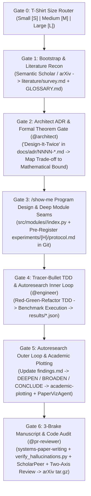

# ADR-to-arXiv Research & Software Factory (`@research-factory`)

This skill fuses the **ADR-Governed Software Factory** (`/Users/tejap/software_factory`) with the **Two-Loop Autonomous arXiv Research Pipeline** (`0-autoresearch-skill`, `systems-paper-writing`, `ml-paper-writing`, `academic-plotting`, `PaperVizAgent`, `ScholarPeer`, and `verify_hallucinations.py`).

Every architectural innovation (e.g., an EMKP Architecture Decision Record like SpiceDB Upward Boundary Pruning or Ancestor-Stitched Filtered HNSW) is engineered simultaneously as:
1. **A Deep-Module, ADR-Governed Production Software Package** (`CONTEXT.md`, `GLOSSARY.md`, `docs/adr/`, `src/modules/<domain>/index.*`), and
2. **A Pre-Registered, Zero-Hallucination Academic Paper Package** (`research-state.yaml`, `findings.md`, `literature/`, `experiments/{H}/protocol.md`, `results/`, `paper/main.tex` -> `arXiv.tar.gz`).

---

## 1. Adaptive Research & Engineering Sizing (`Small [S]` | `Medium [M]` | `Large [L]`)

Before running literature searches, minting ADRs, or executing benchmarks, classify the task into an execution tier (`< 3 seconds`):

| Dimension | 🟢 Small (`[S]` / `/quick`) | 🟡 Medium (`[M]` / Inner-Loop) | 🔴 Large (`[L]` / Outer-Loop & Architecture) |
| :--- | :--- | :--- | :--- |
| **Typical Tasks** | LaTeX typo/prose polish, plot color/font tweak, config constant update, `<= 2 file` bug fix | Running a single hypothesis (`H1.x`), adding a baseline or ablation within existing ADRs & theorems | New architectural mechanism, new mathematical theorem, new Deep Module seam, or research pivot |
| **Research Ceremony (`GSD` / Lit)** | **❌ Skipped** | ⚡ Read `CONTEXT.md`, `findings.md`, & governing ADR | 🔍 Full Literature Survey (`literature/survey.md`) + Ideation (`brainstorming-research-ideas`) |
| **ADR & Mathematical Gate** | **❌ Skipped** | ✅ Verify existing ADR & lock `experiments/{H}/protocol.md` | ✅ **HARD STOP:** Mint `docs/adr/NNNN-*.md` ("Design-It-Twice" -> Theorems) + update `CONTEXT.md` & `GLOSSARY.md` |
| **Program Design (`/show-me`)** | **❌ Skipped** | ✅ Compact 15-line Deep Module seam & metric prediction | ✅ Full Mermaid architecture diagram, Deep Module contracts, & formal theorem proof sketch |
| **Implementation & Inner Loop** | Surgical edit + fast check | Pre-commit `protocol.md` -> Seam TDD (`/tdd`) -> Run benchmark -> Record JSON | Multi-slice Tracer-Bullet TDD -> Full baseline matrix -> Outer-Loop synthesis in `findings.md` |
| **3-Layer Brakes & Verification** | `research_factory.py verify-governance` | `verify-governance` + `verify_hallucinations.py` | Full **3-Brake Suite**: `verify_hallucinations.py` + `PaperVizAgent` ($\ge 95/100$) + `ScholarPeer` + `/two-axis-review` |

---

## 2. Unified Workspace Topology

```text
{project}/
├── CONTEXT.md                    # [Software Factory] System Map, ADR Registry, Module Ownership, Delete-Zone
├── GLOSSARY.md                   # [Software Factory] Ubiquitous Domain Language & Mathematical Symbol Table
├── CODING_STANDARDS.md           # [Software Factory] Deep Module, TDD, & Reproducibility Standards
├── research-state.yaml           # [Autoresearch] Active hypotheses (H1..Hn), status, proxy metrics, trajectory
├── findings.md                   # [Autoresearch] Outer-loop narrative synthesis (backbone of paper Abstract/Intro)
├── research-log.md               # [Autoresearch] Chronological decision & experiment audit trail
├── research_factory.py           # [Unified CLI] Deterministic Sizing, Governance, Protocol Lock, & Paper Auditor
├── docs/
│   ├── adr/                      # [Software Factory] Architecture Decision Records (mapped 1:1 to Paper Theorems)
│   └── rfc/                      # [Software Factory] Multi-module RFCs & Tracer-Bullet DAGs
├── literature/
│   └── survey.md                 # [Autoresearch] Verified papers (Semantic Scholar / arXiv / CrossRef, 0 hallucination)
├── src/
│   └── modules/                  # [Software Factory] Deep Modules (small public index.py seam, private lib/)
├── baselines/                    # [Autoresearch] Reference competitor implementations (e.g., ACORN-1, HoneyBee)
├── experiments/
│   └── {H-slug}/
│       ├── protocol.md           # [Autoresearch] Locked in Git BEFORE running (Hypothesis, Math Bound, Prediction)
│       └── analysis.md           # [Autoresearch] Confirmatory vs. Exploratory synthesis
├── results/                      # [arXiv Pipeline] Deterministic JSON metrics, PaperViz report, ScholarPeer review
└── paper/
    ├── main.tex                  # [systems-paper-writing / ml-paper-writing] Two-column LaTeX manuscript
    ├── references.bib            # Programmatically verified BibTeX entries
    └── figures/                  # [academic-plotting] 300-DPI vector PDFs + PNGs
```

---

## 3. The 6-Gate ADR-to-arXiv Execution Workflow



### Gate 1: Literature Recon & Ubiquitous Language (`Bootstrap`)
1. Search literature via Semantic Scholar, arXiv, and web search; log every verified paper to `literature/survey.md`.
2. Define every domain entity and mathematical symbol ($N, d, \mathcal{G}_{\text{auth}}, \mathcal{T}_{\text{ont}}, S, S_{\text{loc}}, r, \kappa$) in `GLOSSARY.md` so code variable names and LaTeX macros match $1:1$.

### Gate 2: ADR Minting & Theorem Formalization (`@architect`)
1. In the ADR-to-arXiv Factory, **every accepted ADR in `docs/adr/` corresponds directly to a Design Subsection and a Formal Theorem in the paper**:
   - The ADR's **Context & Problem** $\to$ Paper Section 2 (Motivation / Production Observations).
   - The ADR's **Alternatives Considered ("Design-It-Twice")** $\to$ Paper Baselines & Section 3 Trade-off Analysis (Irene Zhang's rule: *discuss every alternative and why your choice wins*).
   - The ADR's **Decision & Invariants** $\to$ Paper Section 3 Formal Theorem & Complexity Bound.
2. Register the ADR in `CONTEXT.md` Section 3 (`Canonical ADR Registry`).

### Gate 3: `/show-me` Blueprint, Deep Module Seam & Protocol Pre-Registration
1. Output a compact `/show-me` structural blueprint showing the Deep Module public seam (`src/modules/<domain>/index.py`) hiding internal complexity (`lib/`).
2. Write `experiments/{H-slug}/protocol.md` stating the exact hypothesis, mathematical prediction, baseline comparisons, and primary metric.
3. **Hard Rule (`0-autoresearch-skill`):** Commit `protocol.md` (`git commit -m "research(protocol): H1 ..."`) **before** running the benchmark.

### Gate 4: Vertical Tracer-Bullet TDD & Inner-Loop Experimentation (`@engineer`)
1. Write failing unit and property tests at the Deep Module seam (`tests/test_<domain>.py`) verifying mathematical invariants (e.g., Theorem 1 exact set equivalence between UBP tokens and naive leaf expansion: zero false positives/negatives).
2. Implement the module until all unit tests pass (`Green`), then execute the benchmark harness against baselines (`baselines/`) and serialize raw outputs to `results/<experiment>_results.json`.

### Gate 5: Outer-Loop Synthesis & `PaperVizAgent` Figure Generation
1. Synthesize empirical results in `findings.md` (separating `CONFIRMATORY` vs. `EXPLORATORY` findings) and update `research-state.yaml`.
2. Decide trajectory direction (`DEEPEN`, `BROADEN`, `PIVOT`, or `CONCLUDE`).
3. Invoke `academic-plotting` (`generate_academic_plots.py`) to render vector PDF figures (`paper/figures/*.pdf`) directly from `results/*.json`, then run `PaperVizAgent` (`run_paperviz_audit.py`) to enforce $\ge 95/100$ across Faithfulness, Conciseness, Readability, and Aesthetics.

### Gate 6: The 3-Brake Manuscript & Code Audit (`@pr-reviewer`)
Before packaging `arXiv_package.tar.gz` or merging a PR, three independent deterministic brakes must pass via `python3 research_factory.py audit-paper`:
1. **Brake 1 — Deterministic Governance & Zero-Hallucination Sensor (`verify-governance` + `verify_hallucinations.py`)**:
   - Verifies `CONTEXT.md <-> docs/adr/` parity, Deep Module encapsulation, and checks that **every numerical claim in `paper/main.tex` exactly matches `results/*.json`** and **every `\cite{}` key exists in `paper/references.bib` with zero placeholders**.
2. **Brake 2 — `ScholarPeer` 4-Agent Adversarial Peer Review (`run_scholarpeer_review.py`)**:
   - Runs the *Sub-Domain Historian*, *Baseline Scout*, *Multi-Aspect Mathematical Q&A Engine*, and *Review Generator* (following Irene Zhang's systems checklist: "X is better for Y in Z", 3-time conclusion statement in section opening, closing, and figure caption).
3. **Brake 3 — Two-Axis Review & Merge/Submission Danger (`/two-axis-review` + `/retro`)**:
   - Evaluates code against `CODING_STANDARDS.md`, scores `One-Way` vs. `Two-Way Door` danger, and logs lessons into `findings.md` ("Lessons and Constraints") so agents never repeat failed experiments.
