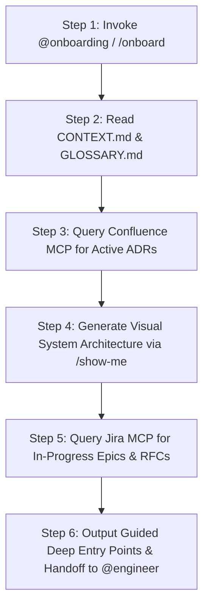
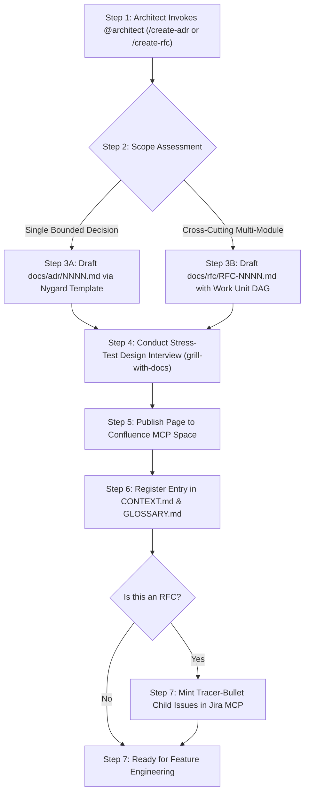
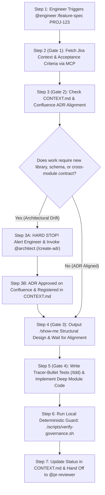
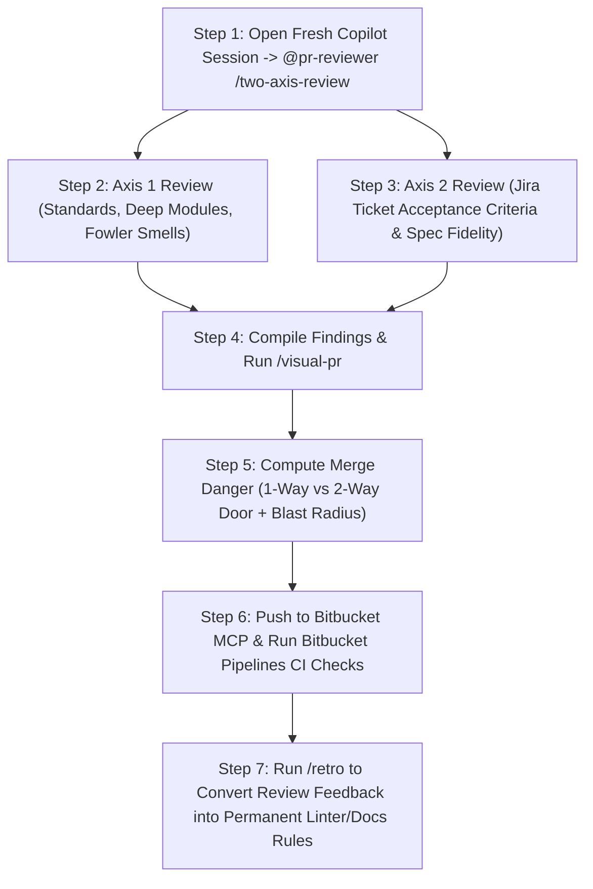
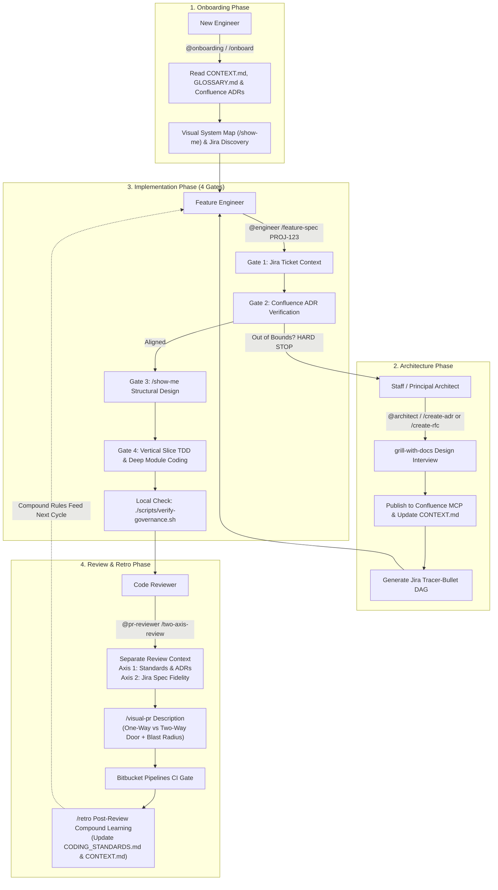

# ADR-Governed Software Factory

An enterprise agent harness for **VS Code GitHub Copilot**, **Jira**, **Confluence**, and **Bitbucket**. This blueprint enforces **Architectural Decision Record (ADR)** governance across autonomous and human development workflows—eliminating architectural drift, undocumented decisions, shallow code, and pull-request review bottlenecks.

---

## Table of Contents
1. [When to Use This Blueprint](#when-to-use-this-blueprint)
2. [Quickstart: How to Use It](#quickstart-how-to-use-it)
3. [Core Persona Workflows & Step-by-Step Flow Diagrams](#core-persona-workflows--step-by-step-flow-diagrams)
   - [Workflow A: New Engineer Onboarding (`@onboarding`)](#workflow-a-new-engineer-onboarding-onboarding)
   - [Workflow B: Staff & Principal Architect (`@architect`)](#workflow-b-staff--principal-architect-architect)
   - [Workflow C: Feature Engineer Delivery (`@engineer`)](#workflow-c-feature-engineer-delivery-engineer)
   - [Workflow D: Code Reviewer & Tech Lead (`@pr-reviewer`)](#workflow-d-code-reviewer--tech-lead-pr-reviewer)
4. [Master End-to-End System Flow](#master-end-to-end-system-flow)
5. [The 4-Gate Governance Model](#the-4-gate-governance-model)
6. [Repository Structure & File Catalog](#repository-structure--file-catalog)
7. [Installed Agent Skills Reference](#installed-agent-skills-reference)

---

## When to Use This Blueprint

| Trigger / Situation | Why Use This Framework | Primary Agent / Prompt |
| :--- | :--- | :--- |
| **New Team Member Onboarding** | Codebase is large, legacy docs are outdated, and tribal knowledge slows down delivery. | `@onboarding` / `/onboard` |
| **Architectural Decisions & RFCs** | Choosing libraries, databases, schemas, or service boundaries that require team alignment and recorded consequences. | `@architect` / `/create-adr`, `/create-rfc` |
| **Feature Development from Jira** | Writing production features where AI code generators frequently drift from system architecture or hallucinate non-standard patterns. | `@engineer` / `/start`, `/feature-spec` |
| **Pull Request Review & PR Overload** | Reviewers suffer from diff fatigue and spend hours commenting on the same repeated standards violations. | `@pr-reviewer` / `/two-axis-review`, `/visual-pr` |
| **Post-Review & Compound Learning** | Preventing repeat review comments by converting reviewer feedback into deterministic checks and living documentation updates. | `@pr-reviewer` / `/retro` |

---

## Quickstart: How to Use It

### 1. Prerequisites
- **VS Code** with the **GitHub Copilot Chat** extension installed.
- **MCP Servers** configured in your VS Code / Claude Code environment:
  - **Jira MCP**: Access to project tickets and backlogs.
  - **Confluence MCP**: Access to team architecture space and ADR pages.
  - **Bitbucket MCP**: Access to repositories, branches, and PR workflows.

### 2. Bootstrap Any Target Repository
To install the agents, prompts, living governance files, and hooks into your repository:

```bash
# Clone this software-factory blueprint
git clone https://github.com/bpoti001/software-factory.git
cd software-factory

# Initialize in your target repository
./scripts/factory-init.sh /path/to/your-target-repo
```

This single command:
1. Copies Copilot instructions ([`.github/copilot-instructions.md`](.github/copilot-instructions.md)), agents ([`.github/agents/`](.github/agents/)), and slash prompts ([`.github/prompts/`](.github/prompts/)).
2. Seeds living governance documents: [`CONTEXT.md`](CONTEXT.md), [`GLOSSARY.md`](GLOSSARY.md), [`CODING_STANDARDS.md`](CODING_STANDARDS.md), [`AGENTS.md`](AGENTS.md), [`docs/adr/`](docs/adr/), and [`docs/rfc/`](docs/rfc/).
3. Installs local Git hooks (`commit-msg` and `pre-push`) to verify ADR compliance before code leaves your machine.
4. Adds Bitbucket Pipelines CI gates to enforce architecture rules on pull requests.

### 3. Day-to-Day Copilot Usage
Open VS Code GitHub Copilot Chat in your project and trigger actions using the specialized agents or slash commands:

- **Autopilot Router**: Type `/start` to have the system guide you to the exact agent and flow needed.
- **Onboarding**: Ask `@onboarding "Explain our payment processing architecture"` or run `/onboard`.
- **Architecting**: Run `/create-adr` or `/create-rfc` to mint a decision.
- **Building**: Run `@engineer /feature-spec PROJ-123` to execute a 4-Gate vertical slice.
- **Reviewing**: Open a new Copilot Chat session and run `/two-axis-review`, `/visual-pr`, and `/retro`.

---

## Core Persona Workflows & Step-by-Step Flow Diagrams

```
                                  USER PERSONA DIRECTORY
  ┌─────────────────────────┐  ┌─────────────────────────┐  ┌─────────────────────────┐  ┌─────────────────────────┐
  │   Workflow A: Onboard   │  │   Workflow B: Architect │  │   Workflow C: Engineer  │  │   Workflow D: Reviewer  │
  │      @onboarding        │  │       @architect        │  │        @engineer        │  │      @pr-reviewer       │
  │   /onboard              │  │ /create-adr /create-rfc │  │ /start     /feature-spec│  │ /two-axis-review /retro │
  └─────────────────────────┘  └─────────────────────────┘  └─────────────────────────┘  └─────────────────────────┘
```

---

### Workflow A: New Engineer Onboarding (`@onboarding`)

**When to use**: When an engineer joins the project, enters a new domain module, or needs to understand existing architectural decisions before writing code.

#### Numbered Execution Steps
1. **Step 1 — Invoke Agent**: Engineer enters `@onboarding` or `/onboard [topic]` in VS Code Copilot Chat.
2. **Step 2 — Read Master Context**: Agent reads [`CONTEXT.md`](CONTEXT.md) (architecture map, ADR registry, delete-zone) and [`GLOSSARY.md`](GLOSSARY.md) (ubiquitous language).
3. **Step 3 — Fetch Authoritative ADRs**: Agent queries the Confluence MCP (`confluence_search`, `confluence_get_page`) to pull full context on active architectural decisions.
4. **Step 4 — Generate Visual Structural Overview**: Agent outputs a `/show-me` visual brief containing call-tree diagrams, module boundaries, and file relationships.
5. **Step 5 — Discovery of Active RFCs & Jira Work**: Agent queries Jira MCP for active tracer bullets and links to in-progress work.
6. **Step 6 — Guided Handoff**: Agent provides deep entry points into the codebase and prompts the engineer to transition to `@engineer` for implementation.

#### Step-by-Step Flow Diagram



---

### Workflow B: Staff & Principal Architect (`@architect`)

**When to use**: When evaluating new third-party libraries, adding database schemas/migrations, defining cross-module boundaries, or introducing new patterns.

#### Numbered Execution Steps
1. **Step 1 — Triage Architectural Scope**: Architect invokes `@architect /create-adr` (for single bounded decisions) or `/create-rfc` (for multi-module cross-cutting initiatives).
2. **Step 2 — Relentless Design Interview (`grill-with-docs`)**: Agent stress-tests the proposal against negative consequences, failure modes, rollback strategies, and the Deletion Test.
3. **Step 3 — Draft Architecture Decision Document**:
   - For ADRs: Populates [`docs/adr/template.md`](docs/adr/template.md) with Context, Alternatives Considered, Decision, Deep Module Interface, and Consequences.
   - For RFCs: Populates [`docs/rfc/template.md`](docs/rfc/template.md) with Problem, Multi-Unit Work DAG, Acceptance Criteria, and Security/Data impact.
4. **Step 4 — Publish to Confluence MCP**: Agent creates or updates the official Confluence page via `confluence_create_page` under the Architecture space.
5. **Step 5 — Register in Local Governance Spine**: Agent adds the ADR/RFC record to [`CONTEXT.md`](CONTEXT.md) Section 3, links the Confluence URL, and updates [`GLOSSARY.md`](GLOSSARY.md).
6. **Step 6 — Generate Tracer-Bullet Jira DAG (RFCs only)**: Agent calls Jira MCP (`jira_create_issue`) to create parent Epics and discrete, parallelizable child tracer-bullet tickets.

#### Step-by-Step Flow Diagram



---

### Workflow C: Feature Engineer Delivery (`@engineer`)

**When to use**: When implementing a Jira ticket, building an API, or delivering a tracer-bullet vertical slice.

#### Numbered Execution Steps
1. **Step 1 — Start Feature Work**: Engineer runs `@engineer /feature-spec PROJ-123` or `/start`.
2. **Step 2 (Gate 1 — Product & Jira)**: Agent fetches Jira ticket `PROJ-123` via `jira_get_issue`, verifying acceptance criteria, tracer-bullet dependencies, and linked parent issues.
3. **Step 3 (Gate 2 — Architecture & ADR Compliance)**: Agent inspects [`CONTEXT.md`](CONTEXT.md) and queries Confluence MCP for relevant ADRs.
   - **Step 3A (Hard Stop Trigger)**: If the requested feature requires a new library, new schema, or cross-cutting contract *not* authorized by existing ADRs, **the agent halts immediately**. It directs the engineer to invoke `@architect /create-adr` before touching code.
4. **Step 4 (Gate 3 — Program Design `/show-me`)**: Agent generates a structural design proposal (file-tree diff, interface contracts, Mermaid sequence) for human approval before implementation.
5. **Step 5 (Gate 4 — Vertical Slice TDD & Implementation)**:
   - Writes red unit/integration tests (`/tdd`).
   - Implements minimal production code conforming to Deep Module rules (public `index.ts` entry point, private `/lib/` or `/internal/`).
   - Verifies all tests pass (green).
6. **Step 6 — Pre-Commit Governance Check**: Agent runs `./scripts/verify-governance.sh` to ensure no deep module seams or delete-zone patterns were violated.
7. **Step 7 — Handoff to Review**: Engineer transitions to `@pr-reviewer` in a separate review context.

#### Step-by-Step Flow Diagram



---

### Workflow D: Code Reviewer & Tech Lead (`@pr-reviewer`)

**When to use**: When opening a Pull Request, conducting code reviews, or running post-merge retrospectives.

#### Numbered Execution Steps
1. **Step 1 — Open Isolated Review Session**: Reviewer opens a fresh VS Code Copilot Chat session (Separate Review Context) and invokes `@pr-reviewer /two-axis-review`.
2. **Step 2 — Axis 1 Audit (Standards & Architecture)**:
   - Reviews diff against [`CODING_STANDARDS.md`](CODING_STANDARDS.md) and active ADRs.
   - Validates module depth, boundary leaks into private internal folders, and Fowler code smells.
3. **Step 3 — Axis 2 Audit (Spec Fidelity)**:
   - Fetches the original Jira issue via Jira MCP.
   - Verifies whether every acceptance criterion is met and flags scope creep, dead code, or hallucinated logic.
4. **Step 4 — Generate Visual PR Description (`/visual-pr`)**:
   - Produces a structural PR description with Before/After evidence.
   - Calculates **Merge Danger**: Classifies as **One-Way Door** vs. **Two-Way Door** and computes the **Blast Radius**.
5. **Step 5 — Publish & Verify**: Submits PR via Bitbucket MCP; Bitbucket Pipelines CI executes `./scripts/verify-governance.sh`.
6. **Step 6 — Post-Merge Retrospective (`/retro`)**:
   - Analyzes reviewer feedback (*"Never write the same review comment twice"*).
   - Codifies feedback into [`CODING_STANDARDS.md`](CODING_STANDARDS.md), adds deterministic lint rules, or updates [`CONTEXT.md`](CONTEXT.md) delete-zone.

#### Step-by-Step Flow Diagram



---

## Master End-to-End System Flow



---

## The 4-Gate Governance Model

Every feature implemented via `@engineer` must pass through 4 deterministic gates before entering production:

```
┌─────────────────────────────────────────────────────────────────────────────┐
│                        THE 4-GATE DELIVERY PIPELINE                         │
├──────────────┬──────────────────┬─────────────────────┬─────────────────────┤
│   GATE 1     │     GATE 2       │       GATE 3        │       GATE 4        │
│   Product    │   Architecture   │   Program Design    │   Vertical Slice    │
│  (Jira MCP)  │ (Confluence MCP) │     (/show-me)      │        (TDD)        │
├──────────────┼──────────────────┼─────────────────────┼─────────────────────┤
│ Validates:   │ Validates:       │ Validates:          │ Validates:          │
│ • Ticket state│ • ADR alignment  │ • Compact call tree │ • Red-green tests   │
│ • Acceptance │ • Deep module    │ • Interface diffs   │ • Private seam lock │
│   criteria   │   seams          │ • Sequence diagram  │ • Zero hallucinated │
│ • Tracer-tag │ • HARD STOP if   │ • Human approval    │   scope             │
│              │   drift detected │   before coding     │ • Passing CI script │
└──────────────┴──────────────────┴─────────────────────┴─────────────────────┘
```

### Merge Danger Taxonomy
When generating PRs via `/visual-pr`, changes are evaluated across two safety dimensions:

1. **One-Way Door vs. Two-Way Door**:
   - **One-Way Door**: High-consequence, irreversible decisions (DB migrations, security models, external API contracts, irreversible data structures). Requires Principal/Architect sign-off.
   - **Two-Way Door**: Easily reversible changes behind feature flags, internal deep module implementations, or non-breaking UI adjustments.
2. **Blast Radius**:
   - Computed based on dependency fan-out, downstream consumers, and potential failure cascades.

---

## Repository Structure & File Catalog

```text
software-factory/
├── .github/
│   ├── copilot-instructions.md          # Always-on instructions with <important if> ADR gates
│   ├── agents/
│   │   ├── onboarding.agent.md          # @onboarding  — Explains architecture & ADRs visually
│   │   ├── architect.agent.md           # @architect   — ADR & RFC gatekeeper (Confluence + Jira)
│   │   ├── engineer.agent.md            # @engineer    — 4-Gate vertical slice implementation agent
│   │   └── pr-reviewer.agent.md         # @pr-reviewer — Two-axis reviewer, /visual-pr & /retro
│   └── prompts/
│       ├── start.prompt.md              # /start       — Autopilot workflow router
│       ├── onboard.prompt.md            # /onboard     — Visual codebase tour
│       ├── feature-spec.prompt.md       # /feature-spec — Jira-backed 4-Gate delivery
│       ├── create-adr.prompt.md         # /create-adr  — Nygard ADR generator & Confluence sync
│       ├── create-rfc.prompt.md         # /create-rfc  — Multi-unit RFC DAG & Jira ticket minting
│       ├── two-axis-review.prompt.md    # /two-axis-review — Parallel standards & spec review
│       ├── visual-pr.prompt.md          # /visual-pr   — Structural PR summary & Merge Danger check
│       └── retro.prompt.md              # /retro       — Post-review compound learning
├── .vscode/
│   ├── settings.json                    # Binds CONTEXT.md and CODING_STANDARDS.md into Copilot Chat
│   └── tasks.json                       # VS Code tasks for governance scripts
├── .agents/
│   └── skills/                          # 43 extracted modular agent skills (ADR, TDD, Design, etc.)
├── docs/
│   ├── agents/
│   │   ├── issue-tracker.md             # Jira + Confluence + Bitbucket MCP tool binding contract
│   │   └── domain.md                    # CONTEXT.md <-> Confluence synchronization rules
│   ├── adr/
│   │   ├── README.md                    # Local ADR register
│   │   ├── template.md                  # Standard Nygard + Deep Module ADR template
│   │   └── 0000-adr-driven-software-factory.md # Foundation ADR for this repository
│   └── rfc/
│       ├── README.md                    # Local RFC register
│       └── template.md                  # Cross-cutting RFC & Tracer-Bullet DAG template
├── scripts/
│   ├── factory-init.sh                  # Bootstrap script for target repositories & git hooks
│   ├── verify-governance.sh             # Fast (<2s) local & CI governance gate check
│   └── publish-github.sh               # Push blueprint updates to remote Git repository
├── CONTEXT.md                           # Master Context Map + Confluence ADR Registry + Delete-Zone
├── GLOSSARY.md                          # Ubiquitous Domain Language dictionary
├── CODING_STANDARDS.md                  # Review checklist, Fowler 12 Smells, & immutability rules
├── AGENTS.md                            # Universal Agent Harness Entry Point (VS Code, Claude, Codex)
├── CLAUDE.md                            # Claude Code harness entry point
└── bitbucket-pipelines.yml              # Server-side CI enforcement for ADR and seam boundaries
```

---

## Installed Agent Skills Reference

All 43 agent skills reside in [`.agents/skills/`](.agents/skills/) and are symlinked into `~/.agents/skills/`:

| Capability Domain | Skills | Description |
| :--- | :--- | :--- |
| **Architecture & Decisions** | `architecture-decision-records`, `ralphinho-rfc-pipeline`, `context-and-decisions`, `living-docs-governance`, `grill-with-docs` | Nygard ADR lifecycle, multi-unit RFC DAG decomposition, stress-test design interviews, and Confluence sync. |
| **Deep Module Design** | `codebase-design`, `improve-codebase-architecture`, `setup-ts-deep-modules`, `domain-modeling` | John Ousterhout's Deep Module methodology, seam enforcement, and dependency boundary verification. |
| **Engineering & TDD** | `rpi`, `show-me`, `tdd`, `implement`, `implement-spec`, `diagnosing-bugs`, `software-factory` | 4-Gate delivery, visual program design, red-green-refactor vertical slices, and bug diagnosis loops. |
| **Code Review & Quality** | `code-review`, `pr`, `visual-pr`, `retro`, `coding-standards`, `narrow-react-prop-types` | Two-axis review, visual PR diffs with Merge Danger scoring, and compound learning retrospectives. |
| **Harness & Automation** | `jira-integration`, `codebase-onboarding`, `improve-claude-md`, `design-control-loop`, `build-iterated-agentic-loop` | MCP tool integrations, `<important if>` instruction tuning, and autonomous control loops. |

---

## Verification & CI Enforcement

Run the deterministic governance check locally before pushing:

```bash
./scripts/verify-governance.sh
```

### What It Verifies in `< 2 seconds`:
1. **Deep Module Seam Boundary**: Flags any import that crosses module boundaries into private `/lib/` or `/internal/` directories.
2. **Structural Drift Gate**: If package manifests (`package.json`, `pom.xml`, etc.), database schemas/migrations, or new module roots change without an accompanying update to `CONTEXT.md` or `docs/adr/`, the build fails.
3. **Delete-Zone Guard**: Scans changed files against deprecated patterns registered in Section 5 of `CONTEXT.md` to prevent zombie code recreation.
