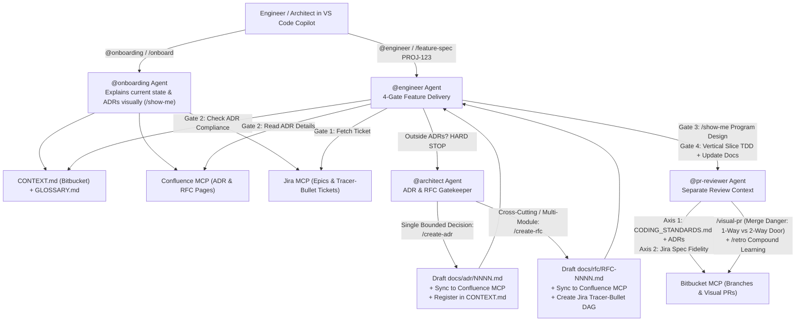

# ADR-Governed Software Factory — Copilot Agents, Skills & MCP Blueprint

This repository contains the complete **Software Factory** configuration, pulled skills, governance templates, and **VS Code GitHub Copilot Agents** designed to scale AI-assisted development across engineers and architects using **Bitbucket**, **Confluence**, and **Jira** MCPs.

---

## 1. Skills Pulled from the Two Videos + ECC + GSD

All 43 upstream skills have been pulled into [`.agents/skills/`](./.agents/skills/) (and linked into `~/.agents/skills/` for global availability):

### Video 1: Matt Pocock — *"Fixing the PR Bottleneck"* (`mattpocock/skills`)
- **Three-Layer PR Brakes & Separate Review Context**:
  - [`code-review`](./.agents/skills/code-review/SKILL.md): Two-axis parallel sub-agent review (**Standards** vs. **Spec**).
  - [`pr`](./.agents/skills/pr/SKILL.md): Visual PR summary + Before/After evidence + **Merge Danger** (`One-Way Door` vs. `Two-Way Door` + `Blast Radius`).
  - [`retro`](./.agents/skills/retro/SKILL.md): Post-session retrospective (*"Never write the same review comment twice"*) turning review comments into deterministic checks, `CODING_STANDARDS.md` rules, and `CONTEXT.md` pointers.
- **Deep Modules & Domain Modeling**:
  - [`codebase-design`](./.agents/skills/codebase-design/SKILL.md): Ousterhout's Deep Modules, seams, adapters, leverage, locality, the Deletion Test, and Design-It-Twice.
  - [`improve-codebase-architecture`](./.agents/skills/improve-codebase-architecture/SKILL.md): Scans for shallow modules and generates a visual before/after HTML deepening report.
  - [`setup-ts-deep-modules`](./.agents/skills/setup-ts-deep-modules/SKILL.md): Enforces deep module entry-point boundaries deterministically via `dependency-cruiser`.
  - [`domain-modeling`](./.agents/skills/domain-modeling/SKILL.md) & [`grill-with-docs`](./.agents/skills/grill-with-docs/SKILL.md): Relentless design interview that sharpens `GLOSSARY.md` and creates ADRs inline.
  - [`to-spec`](./.agents/skills/to-spec/SKILL.md), [`to-tickets`](./.agents/skills/to-tickets/SKILL.md), [`implement`](./.agents/skills/implement/SKILL.md), [`implement-spec`](./.agents/skills/implement-spec/SKILL.md), [`wayfinder`](./.agents/skills/wayfinder/SKILL.md), [`tdd`](./.agents/skills/tdd/SKILL.md), [`diagnosing-bugs`](./.agents/skills/diagnosing-bugs/SKILL.md), [`software-factory`](./.agents/skills/software-factory/SKILL.md).

### Video 2: Dexter Horthy (HumanLayer) — *"State of Software Factories // Slop Bench"* (`humanlayer/skills`)
- [`rpi`](./.agents/skills/rpi/SKILL.md): Research-Plan-Implement 4-Gate workflow (Product -> System Architecture -> Program Design -> Vertical Slices).
- [`show-me`](./.agents/skills/show-me/SKILL.md): Visual alignment via compact call-tree diffs, file-tree diffs, pseudocode, Mermaid sequence diagrams, and HTML mockups.
- [`visual-pr`](./.agents/skills/visual-pr/SKILL.md): Structural visual PR descriptions that cut human review time from hours to minutes.
- [`improve-claude-md`](./.agents/skills/improve-claude-md/SKILL.md): Uses `<important if="...">` conditional XML blocks to maximize instruction adherence.
- [`narrow-react-prop-types`](./.agents/skills/narrow-react-prop-types/SKILL.md), [`design-control-loop`](./.agents/skills/design-control-loop/SKILL.md), [`build-iterated-agentic-loop`](./.agents/skills/build-iterated-agentic-loop/SKILL.md).

### Hackathon Winner Stack: Everything Claude Code (`affaan-m/everything-claude-code`)
- [`architecture-decision-records`](./.agents/skills/architecture-decision-records/SKILL.md): Nygard ADR lifecycle management.
- [`ralphinho-rfc-pipeline`](./.agents/skills/ralphinho-rfc-pipeline/SKILL.md): Multi-unit RFC DAG decomposition with acceptance tests and rollback plans.
- [`context-and-decisions`](./.agents/skills/context-and-decisions/SKILL.md) & [`living-docs-governance`](./.agents/skills/living-docs-governance/SKILL.md): Constitution, Map, Status, Delete-Zone, and History governance.
- [`jira-integration`](./.agents/skills/jira-integration/SKILL.md) & [`codebase-onboarding`](./.agents/skills/codebase-onboarding/SKILL.md).

---

## 2. How the Copilot Agents Work Together (Bitbucket + Confluence + Jira MCP)



---

## 3. Quick Start: Copying into Your Enterprise Bitbucket Repository

Copy the following folders/files into the root of your Bitbucket repository:

```text
your-repo/
├── .github/
│   ├── copilot-instructions.md          # Always-on rules with <important if> blocks & ADR gate
│   ├── agents/
│   │   ├── onboarding.agent.md          # @onboarding — Project state & ADR navigator
│   │   ├── architect.agent.md           # @architect  — ADR & RFC gatekeeper (Confluence + Jira MCP)
│   │   ├── engineer.agent.md            # @engineer   — GSD + 4-Gate vertical-slice builder
│   │   └── pr-reviewer.agent.md         # @pr-reviewer — Two-Axis reviewer, /visual-pr & /retro
│   └── prompts/
│       ├── onboard.prompt.md            # /onboard
│       ├── feature-spec.prompt.md       # /feature-spec
│       ├── create-adr.prompt.md         # /create-adr
│       ├── create-rfc.prompt.md         # /create-rfc
│       ├── two-axis-review.prompt.md    # /two-axis-review
│       ├── visual-pr.prompt.md          # /visual-pr
│       └── retro.prompt.md              # /retro
├── .vscode/
│   └── settings.json                    # Wires CONTEXT.md & CODING_STANDARDS.md into Copilot Chat
├── .agents/
│   └── skills/                          # All 43 pulled skills from Matt Pocock, HumanLayer, and ECC
├── CONTEXT.md                           # Master Context Map + Confluence ADR Registry + Delete-Zone
├── GLOSSARY.md                          # Ubiquitous Domain Language dictionary
├── CODING_STANDARDS.md                  # Separate-context review rules & Fowler 12 Smells
├── AGENTS.md                            # Universal agent harness entry point
└── docs/
    ├── agents/
    │   ├── issue-tracker.md             # Jira + Confluence + Bitbucket MCP binding rules
    │   └── domain.md                    # Hybrid CONTEXT.md <-> Confluence ADR sync rules
    ├── adr/
    │   ├── README.md                    # Local ADR index
    │   ├── template.md                  # Nygard + Deep Module + Confluence ADR template
    │   └── 0000-adr-driven-software-factory.md
    └── rfc/
        ├── README.md                    # Local RFC index
        └── template.md                  # Cross-cutting RFC + Tracer-Bullet Jira DAG template
```
