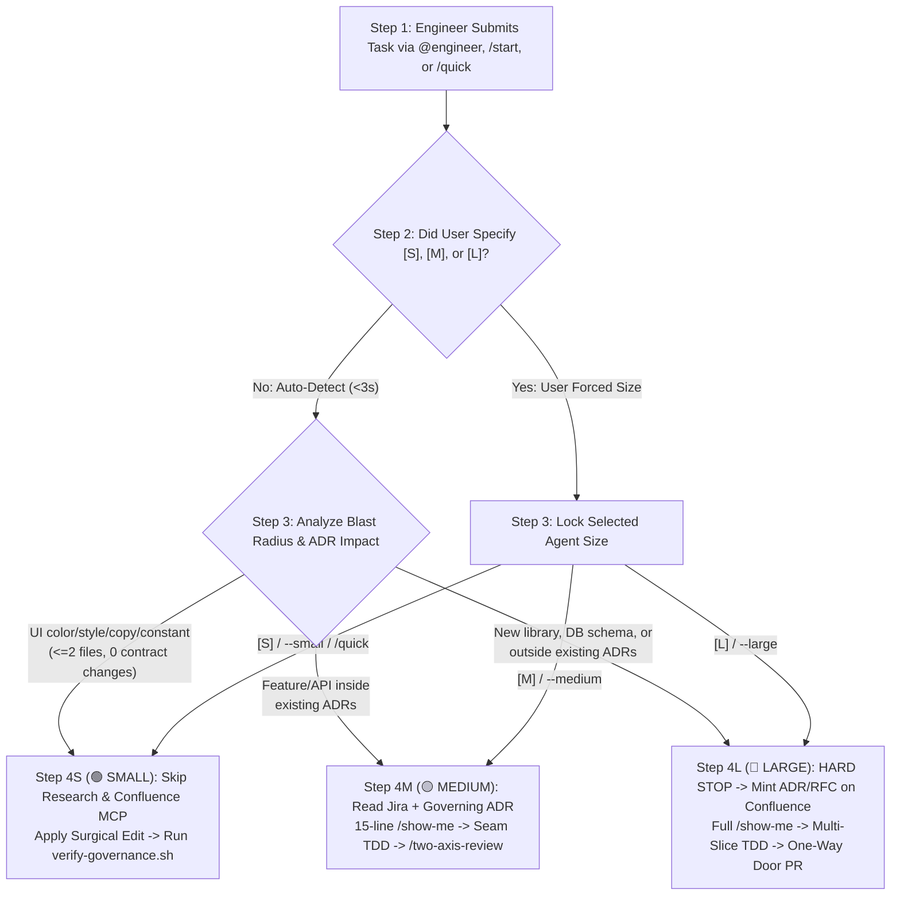
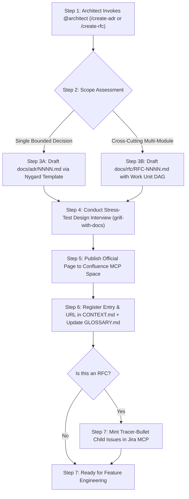
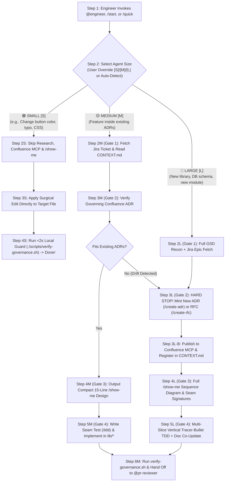
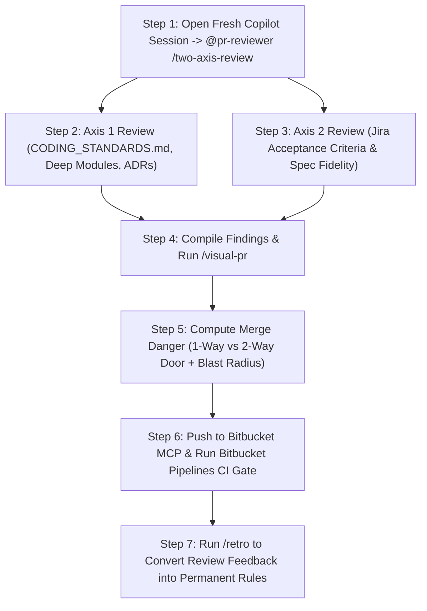
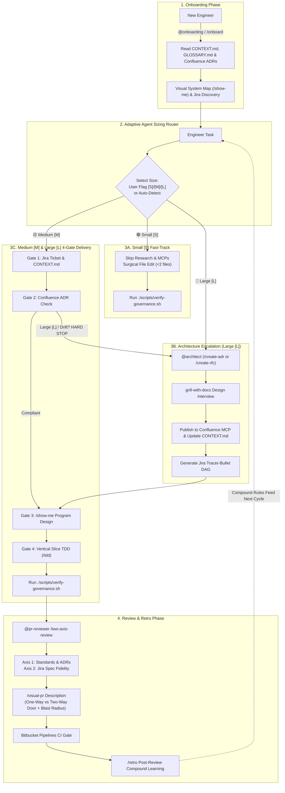

# ADR-Governed Software Factory

An enterprise agent harness for **VS Code GitHub Copilot**, **Jira**, **Confluence**, and **Bitbucket**. This blueprint enforces **Architectural Decision Record (ADR)** governance across autonomous and human development workflows—while dynamically scaling agent depth (`Small` / `Medium` / `Large`) so trivial UI tweaks happen in seconds without research overhead, and complex features follow strict architectural gates.

---

## Table of Contents
1. [When to Use This Blueprint](#when-to-use-this-blueprint)
2. [Adaptive Agent Sizing (`Small` | `Medium` | `Large`)](#adaptive-agent-sizing-small--medium--large)
3. [Quickstart: How to Use It](#quickstart-how-to-use-it)
4. [Core Persona Workflows & Step-by-Step Flow Diagrams](#core-persona-workflows--step-by-step-flow-diagrams)
   - [Workflow A: New Engineer Onboarding (`@onboarding`)](#workflow-a-new-engineer-onboarding-onboarding)
   - [Workflow B: Staff & Principal Architect (`@architect`)](#workflow-b-staff--principal-architect-architect)
   - [Workflow C: Feature Engineer Delivery (`@engineer` — Small, Medium & Large)](#workflow-c-feature-engineer-delivery-engineer--small-medium--large)
   - [Workflow D: Code Reviewer & Tech Lead (`@pr-reviewer`)](#workflow-d-code-reviewer--tech-lead-pr-reviewer)
5. [Master End-to-End System Flow](#master-end-to-end-system-flow)
6. [The 4-Gate Governance Model](#the-4-gate-governance-model)
7. [Repository Structure & File Catalog](#repository-structure--file-catalog)
8. [Installed Agent Skills Reference](#installed-agent-skills-reference)

---

## When to Use This Blueprint

| Trigger / Situation | Recommended Agent / Prompt | Agent Size | Why Use This Flow |
| :--- | :--- | :--- | :--- |
| **Changing a button color, fixing a typo, or tweaking CSS/config** | `@engineer [S]` or `/quick` | **🟢 Small (`[S]`)** | **Zero research overhead.** Skips Confluence, Jira, and `/show-me` ceremony; makes the surgical edit directly. |
| **Building a feature or API endpoint within existing architecture** | `@engineer [M]` or `/start PROJ-123` | **🟡 Medium (`[M]`)** | Verifies existing ADRs, shows a compact 15-line `/show-me` interface diff, and builds via vertical-slice TDD. |
| **Adding a new library, DB table/schema, or cross-module contract** | `@engineer [L]` or `/feature-spec` | **🔴 Large (`[L]`)** | **Hard Stop on drift.** Mints a new ADR (`/create-adr`) or RFC (`/create-rfc`) on Confluence before writing production code. |
| **Onboarding to the project or exploring an unfamiliar module** | `@onboarding` or `/onboard` | **N/A (Read-Only)** | Reads `CONTEXT.md`, `GLOSSARY.md`, and Confluence ADRs to generate a visual `/show-me` system tour. |
| **Reviewing a Pull Request or running a post-merge retrospective** | `@pr-reviewer` or `/two-axis-review` | **N/A (Review)** | Audits Standards/ADRs vs. Jira Spec in a separate context and scores **Merge Danger** (`One-Way` vs. `Two-Way Door`). |

---

## Adaptive Agent Sizing (`Small` | `Medium` | `Large`)

Not every task deserves the same ceremony. An engineer changing the color of a button should **never** wait for deep codebase research (`GSD`), Confluence MCP queries, or `/show-me` architecture blueprints.

The Software Factory uses **T-Shirt Agent Sizing (`Small [S]` | `Medium [M]` | `Large [L]`)** with **Dual-Mode Selection**:

### 1. How the Size is Chosen
- **Mode A — User-Explicit Override (Developer sets it)**:
  Pass `[S]`, `[M]`, or `[L]` (or `--small`, `--medium`, `--large`, or `/quick`) in your Copilot prompt to lock the agent into that exact execution tier:
  - `@engineer [S] Change primary submit button color to #2563EB` (or `/quick Change primary submit button color to #2563EB`)
  - `@engineer [M] PROJ-123 Add pagination to user transactions endpoint`
  - `@engineer [L] PROJ-456 Introduce Redis caching layer for session tokens`
- **Mode B — Automatic Scope Detection (Default when omitted)**:
  When you run `/start` or `@engineer <task>` without a size flag, the agent evaluates the blast radius in `< 3 seconds` and picks `Small [S]`, `Medium [M]`, or `Large [L]` automatically.

### 2. Execution Matrix by Agent Size

| Dimension | 🟢 Small (`[S]` / `/quick`) | 🟡 Medium (`[M]`) | 🔴 Large (`[L]`) |
| :--- | :--- | :--- | :--- |
| **Typical Tasks** | Change button color, fix copy/typo, adjust CSS spacing, update constant, `<= 2 file` bug fix | New endpoint, UI component with state, business logic update inside 1–2 existing modules | New package/library, DB migration/schema change, new Deep Module, cross-team contract |
| **How User Sets It** | `@engineer [S] ...` / `/start --small` / `/quick` | `@engineer [M] ...` / `/start --medium` | `@engineer [L] ...` / `/start --large` |
| **Deep Research (`GSD`)** | **❌ Skipped** | ⚡ Targeted module recon (`index.*`) | 🔍 Full multi-module codebase recon |
| **Confluence & Jira MCP** | **❌ Skipped** | ✅ Reads Jira ticket + 1–2 governing ADRs | ✅ Reads & **publishes** new ADR/RFC to Confluence + creates Jira DAG |
| **Program Design (`/show-me`)** | **❌ Skipped** | ✅ Compact 15-line interface & file-tree diff | ✅ Full call-tree, Mermaid sequence diagram & seam contracts |
| **Implementation & Testing** | Direct surgical edit + existing unit check | Red-Green-Refactor TDD (`/tdd`) at module seam | Multi-slice Vertical Tracer-Bullet TDD (`/tdd`) |
| **Governance & PR Review** | Fast `<2s` `./scripts/verify-governance.sh` | `/two-axis-review` + `/visual-pr` (`Two-Way Door`) | `/two-axis-review` + `/visual-pr` (`One-Way Door`) + `/retro` |

### 3. Agent Size Router Flow Diagram



---

## Quickstart: How to Use It

### 1. Prerequisites
- **VS Code** with the **GitHub Copilot Chat** extension installed.
- **MCP Servers** configured in your VS Code environment:
  - **Jira MCP**: Access to project tickets and backlogs.
  - **Confluence MCP**: Access to team architecture space and ADR pages.
  - **Bitbucket MCP**: Access to repositories, branches, and PR workflows.

### 2. Bootstrap Any Target Repository
Install the agents, prompts, living governance files, and local Git hooks into your repository with a single command:

```bash
# Clone this software-factory blueprint
git clone https://github.com/bpoti001/software-factory.git
cd software-factory

# Initialize in your target repository
./scripts/factory-init.sh /path/to/your-target-repo
```

This script automatically:
1. Copies Copilot instructions ([`.github/copilot-instructions.md`](.github/copilot-instructions.md)), agents ([`.github/agents/`](.github/agents/)), and slash prompts ([`.github/prompts/`](.github/prompts/)).
2. Seeds living governance documents: [`CONTEXT.md`](CONTEXT.md), [`GLOSSARY.md`](GLOSSARY.md), [`CODING_STANDARDS.md`](CODING_STANDARDS.md), [`AGENTS.md`](AGENTS.md), [`docs/adr/`](docs/adr/), and [`docs/rfc/`](docs/rfc/).
3. Installs local Git hooks (`commit-msg` and `pre-push`) to verify ADR compliance before code leaves your laptop.
4. Adds Bitbucket Pipelines CI gates ([`bitbucket-pipelines.yml`](bitbucket-pipelines.yml)) to enforce architecture rules on pull requests.

### 3. Day-to-Day Copilot Command Reference

| What You Want To Do | Command in VS Code Copilot Chat |
| :--- | :--- |
| **Quick UI/copy/style change (Skip research)** | `/quick Change primary button color to #2563EB` *or* `@engineer [S] Fix header typo` |
| **Auto-sized feature execution from current Git branch** | `/start` *(auto-detects Jira key from branch + auto-picks `[S]`, `[M]`, or `[L]`)* |
| **Standard feature with explicit Medium size** | `@engineer [M] /feature-spec PROJ-123` |
| **Large architectural feature with ADR/RFC gate** | `@engineer [L] /feature-spec PROJ-456` |
| **Onboard to the codebase or a specific module** | `@onboarding /onboard Explain the checkout module and its active ADRs` |
| **Create a new Architecture Decision Record (ADR)** | `@architect /create-adr Use Postgres LISTEN/NOTIFY for cache invalidation` |
| **Create a cross-cutting RFC & Jira Tracer-Bullet DAG** | `@architect /create-rfc Multi-region active-active tenant routing` |
| **Review your branch in a clean context before PR** | `@pr-reviewer /two-axis-review` |
| **Generate a visual Bitbucket PR with Merge Danger** | `@pr-reviewer /visual-pr` |
| **Turn PR review comments into permanent rules** | `@pr-reviewer /retro` |

---

## Core Persona Workflows & Step-by-Step Flow Diagrams

```
                                  USER PERSONA DIRECTORY
  ┌─────────────────────────┐  ┌─────────────────────────┐  ┌─────────────────────────┐  ┌─────────────────────────┐
  │   Workflow A: Onboard   │  │   Workflow B: Architect │  │   Workflow C: Engineer  │  │   Workflow D: Reviewer  │
  │      @onboarding        │  │       @architect        │  │  @engineer [S]/[M]/[L]  │  │      @pr-reviewer       │
  │   /onboard              │  │ /create-adr /create-rfc │  │ /quick /start /feature  │  │ /two-axis-review /retro │
  └─────────────────────────┘  └─────────────────────────┘  └─────────────────────────┘  └─────────────────────────┘
```

---

### Workflow A: New Engineer Onboarding (`@onboarding`)

**When to use**: When an engineer joins the project, enters an unfamiliar domain module, or needs to understand existing architectural decisions before writing code.

#### Numbered Execution Steps
1. **Step 1 — Invoke Agent**: Engineer enters `@onboarding` or `/onboard [topic]` in VS Code Copilot Chat.
2. **Step 2 — Read Master Context**: Agent reads [`CONTEXT.md`](CONTEXT.md) (architecture map, ADR registry, delete-zone) and [`GLOSSARY.md`](GLOSSARY.md) (ubiquitous domain language).
3. **Step 3 — Fetch Authoritative ADRs**: Agent queries the Confluence MCP (`confluence_search`, `confluence_get_page`) to pull full context on active architectural decisions.
4. **Step 4 — Generate Visual Structural Overview**: Agent outputs a `/show-me` visual brief containing call-tree diagrams, Deep Module boundaries, and file relationships.
5. **Step 5 — Discovery of Active RFCs & Jira Work**: Agent queries Jira MCP for active tracer-bullet tickets and links to in-progress work.
6. **Step 6 — Guided Handoff**: Agent provides deep entry points into the codebase and recommends the appropriate `@engineer` size (`[S]`, `[M]`, or `[L]`) for the engineer's first task.

#### Step-by-Step Flow Diagram


---

### Workflow B: Staff & Principal Architect (`@architect`)

**When to use**: When evaluating new third-party libraries, adding database schemas/migrations, defining cross-module boundaries, or resolving a `Large [L]` escalation from `@engineer`.

#### Numbered Execution Steps
1. **Step 1 — Triage Architectural Scope**: Architect invokes `@architect /create-adr` (for single bounded decisions) or `/create-rfc` (for multi-module cross-cutting initiatives).
2. **Step 2 — Relentless Design Interview (`grill-with-docs`)**: Agent stress-tests the proposal against negative consequences, failure modes, rollback strategies, and Ousterhout's Deletion Test.
3. **Step 3 — Draft Architecture Decision Document**:
   - **Step 3A (ADR)**: Populates [`docs/adr/template.md`](docs/adr/template.md) with Context, Alternatives Considered, Decision, Deep Module Interface, and Consequences.
   - **Step 3B (RFC)**: Populates [`docs/rfc/template.md`](docs/rfc/template.md) with Problem, Multi-Unit Work DAG, Acceptance Criteria, and Expand-Contract migration plan.
4. **Step 4 — Publish to Confluence MCP**: Agent creates or updates the official Confluence page via `confluence_create_page` under the Architecture space.
5. **Step 5 — Register in Local Governance Spine**: Agent adds the ADR/RFC entry and Confluence URL to [`CONTEXT.md`](CONTEXT.md) Section 3/4 and updates [`GLOSSARY.md`](GLOSSARY.md).
6. **Step 6 — Generate Tracer-Bullet Jira DAG (RFCs only)**: Agent calls Jira MCP (`jira_create_issue`) to create parent Epics and parallelizable child tracer-bullet tickets.

#### Step-by-Step Flow Diagram



---

### Workflow C: Feature Engineer Delivery (`@engineer` — Small, Medium & Large)

**When to use**: Whenever an engineer is writing or modifying code—from changing a button color (`Small [S]`) to building a standard Jira feature (`Medium [M]`) or introducing new architecture (`Large [L]`).

#### Path 1: `🟢 Small [S]` Execution Steps (UI tweaks, button color, copy, tiny fixes)
1. **Step 1 — Invoke with Small Size**: Engineer runs `/quick Change button color to blue` or `@engineer [S] ...` (or `/start` auto-detects `Small [S]`).
2. **Step 2S — Skip All Research Ceremony**: Agent bypasses `CONTEXT.md`, Confluence MCP, Jira MCP, and `/show-me` design docs.
3. **Step 3S — Surgical Edit**: Agent locates the exact file and makes the change directly.
4. **Step 4S — Fast Local Guard**: Agent runs `./scripts/verify-governance.sh` (`< 2s`) to verify no module seam or delete-zone rules were broken, and finishes.

#### Path 2: `🟡 Medium [M]` Execution Steps (Features within existing ADRs)
1. **Step 1 — Invoke with Medium Size**: Engineer runs `@engineer [M] /feature-spec PROJ-123` (or `/start` auto-detects `Medium [M]`).
2. **Step 2M (Gate 1 — Jira & Context)**: Agent fetches `PROJ-123` from Jira MCP and reads `CONTEXT.md` + `GLOSSARY.md`.
3. **Step 3M (Gate 2 — ADR Check)**: Agent checks the governing ADR on Confluence MCP and confirms compliance.
4. **Step 4M (Gate 3 — Compact `/show-me`)**: Agent outputs a 15-line file-tree diff and public interface signature (`index.*`) before writing function bodies.
5. **Step 5M (Gate 4 — Seam TDD)**: Agent writes a failing test at the module's public entry point (`index.*`), implements the logic in `lib/*`, and passes all tests.
6. **Step 6M — Review Handoff**: Agent runs `./scripts/verify-governance.sh` and hands off to `@pr-reviewer`.

#### Path 3: `🔴 Large [L]` Execution Steps (New library, DB schema, or outside ADRs)
1. **Step 1 — Invoke or Escalate to Large Size**: Engineer runs `@engineer [L] /feature-spec PROJ-456` (or escalates from `Medium [M]` when ADR drift is detected).
2. **Step 2L (Gate 1 — Deep GSD Recon)**: Agent inspects Jira Epic/ticket, `CONTEXT.md`, and all impacted modules.
3. **Step 3L (Gate 2 — HARD STOP & Mint ADR/RFC)**: Agent halts coding, invokes `@architect` (`/create-adr` or `/create-rfc`), publishes the new decision to **Confluence MCP**, and updates `CONTEXT.md`.
4. **Step 4L (Gate 3 — Full `/show-me` Blueprint)**: Agent outputs full file-tree diff, Mermaid sequence diagram, and Deep Module boundary contracts.
5. **Step 5L (Gate 4 — Multi-Slice Tracer-Bullet TDD)**: Agent implements vertical slices end-to-end via TDD, updates `CONTEXT.md` & `GLOSSARY.md`, and hands off to `@pr-reviewer` (`One-Way Door` review).

#### Step-by-Step Flow Diagram (`Small [S]` vs `Medium [M]` vs `Large [L]`)



---

### Workflow D: Code Reviewer & Tech Lead (`@pr-reviewer`)

**When to use**: When opening a Pull Request, conducting code reviews, or running post-merge retrospectives.

#### Numbered Execution Steps
1. **Step 1 — Open Isolated Review Session**: Reviewer opens a fresh VS Code Copilot Chat session (Separate Review Context) and invokes `@pr-reviewer /two-axis-review`.
2. **Step 2 — Axis 1 Audit (Standards & Architecture)**:
   - Reviews diff against [`CODING_STANDARDS.md`](CODING_STANDARDS.md) and active ADRs.
   - Validates Deep Module depth, boundary leaks into private `/lib/` folders, and Fowler code smells.
3. **Step 3 — Axis 2 Audit (Spec Fidelity)**:
   - Fetches the originating Jira issue via Jira MCP.
   - Verifies every acceptance criterion is met and flags scope creep, dead code, or hallucinated logic.
4. **Step 4 — Generate Visual PR Description (`/visual-pr`)**:
   - Produces a structural PR summary with Before/After evidence.
   - Calculates **Merge Danger**: Classifies as **One-Way Door** vs. **Two-Way Door** and computes the **Blast Radius**.
5. **Step 5 — Publish & Verify**: Submits PR via Bitbucket MCP; Bitbucket Pipelines CI executes `./scripts/verify-governance.sh`.
6. **Step 6 — Post-Merge Retrospective (`/retro`)**:
   - Analyzes reviewer feedback (*"Never write the same review comment twice"*).
   - Codifies feedback into [`CODING_STANDARDS.md`](CODING_STANDARDS.md), adds deterministic lint rules, or updates [`CONTEXT.md`](CONTEXT.md) delete-zone.

#### Step-by-Step Flow Diagram



---

## Master End-to-End System Flow



---

## The 4-Gate Governance Model

All **Medium `[M]`** and **Large `[L]`** features pass through 4 deterministic gates before entering production (while **Small `[S]`** tasks bypass Gates 1–3 and go straight to surgical edit + boundary verification):

```
┌─────────────────────────────────────────────────────────────────────────────┐
│              THE 4-GATE DELIVERY PIPELINE (MEDIUM [M] & LARGE [L])          │
├──────────────┬──────────────────┬─────────────────────┬─────────────────────┤
│   GATE 1     │     GATE 2       │       GATE 3        │       GATE 4        │
│   Product    │   Architecture   │   Program Design    │   Vertical Slice    │
│  (Jira MCP)  │ (Confluence MCP) │     (/show-me)      │        (TDD)        │
├──────────────┼──────────────────┼─────────────────────┼─────────────────────┤
│ Validates:   │ Validates:       │ Validates:          │ Validates:          │
│ • Ticket spec│ • ADR alignment  │ • Compact call tree │ • Red-green tests   │
│ • Acceptance │ • Deep module    │ • Interface diffs   │ • Private seam lock │
│   criteria   │   seams          │ • Sequence diagram  │ • Zero hallucinated │
│ • Tracer-tag │ • HARD STOP if   │ • Human alignment   │   scope             │
│              │   drift detected │   before coding     │ • Passing CI script │
└──────────────┴──────────────────┴─────────────────────┴─────────────────────┘
```

### Merge Danger Taxonomy
When generating PRs via `/visual-pr`, changes are evaluated across two safety dimensions:

1. **One-Way Door vs. Two-Way Door**:
   - **One-Way Door (`Large [L]`)**: High-consequence, hard-to-reverse decisions (DB migrations, security models, external API contracts, irreversible data structures). Requires Principal/Architect sign-off and an approved Confluence ADR/RFC.
   - **Two-Way Door (`Small [S]` / `Medium [M]`)**: Easily reversible changes behind feature flags, internal deep module implementations, or non-breaking UI adjustments.
2. **Blast Radius**:
   - Classified as `Localized` (`Small [S]`), `Module-Wide` (`Medium [M]`), or `System-Wide` (`Large [L]`).

---

## Repository Structure & File Catalog

```text
software-factory/
├── .github/
│   ├── copilot-instructions.md          # Always-on rules with Adaptive Sizing ([S]/[M]/[L]) & ADR gates
│   ├── agents/
│   │   ├── onboarding.agent.md          # @onboarding  — Explains architecture & ADRs visually
│   │   ├── architect.agent.md           # @architect   — ADR & RFC gatekeeper (Confluence + Jira)
│   │   ├── engineer.agent.md            # @engineer    — Adaptive Small/Medium/Large builder
│   │   └── pr-reviewer.agent.md         # @pr-reviewer — Two-axis reviewer, /visual-pr & /retro
│   └── prompts/
│       ├── start.prompt.md              # /start       — Autopilot router (auto-detects or accepts [S]/[M]/[L])
│       ├── quick.prompt.md              # /quick       — Forces Small [S] zero-research surgical mode
│       ├── onboard.prompt.md            # /onboard     — Visual codebase tour
│       ├── feature-spec.prompt.md       # /feature-spec — Adaptive 4-Gate Jira feature delivery
│       ├── create-adr.prompt.md         # /create-adr  — Nygard ADR generator & Confluence sync
│       ├── create-rfc.prompt.md         # /create-rfc  — Multi-unit RFC DAG & Jira ticket minting
│       ├── two-axis-review.prompt.md    # /two-axis-review — Parallel standards & spec review
│       ├── visual-pr.prompt.md          # /visual-pr   — Structural PR summary & Merge Danger check
│       └── retro.prompt.md              # /retro       — Post-review compound learning
├── .vscode/
│   ├── settings.json                    # Binds CONTEXT.md and CODING_STANDARDS.md into Copilot Chat
│   └── tasks.json                       # VS Code tasks for governance scripts
├── .agents/
│   └── skills/                          # 43 modular agent skills (ADR, TDD, Deep Modules, Review)
├── src/
│   ├── cli/
│   │   └── factory.mjs                  # Executable CLI adapter (size | verify | pr-report)
│   └── modules/
│       ├── sizing/                      # Deep Module (ADR-0001, ADR-0002): Small/Medium/Large + Safety Escalation
│       │   ├── index.mjs                # Public Seam: classifyTaskSize
│       │   └── lib/classifier.mjs       # Private implementation
│       ├── governance/                  # Deep Module (ADR-0001, ADR-0003, ADR-0004): Seam, Drift & ADR Parity
│       │   ├── index.mjs                # Public Seam: verifyGovernance, parseAdrRegistry
│       │   └── lib/*                    # Private implementation
│       └── review/                      # Deep Module (ADR-0001, ADR-0005): Merge Danger & /visual-pr
│           ├── index.mjs                # Public Seam: assessMergeDanger, generateVisualPrBody
│           └── lib/*                    # Private implementation
├── tests/
│   ├── sizing.seam.test.mjs             # Seam tests for Adaptive Agent Sizing (ADR-0002)
│   ├── governance.seam.test.mjs         # Seam tests for Seam, Drift, Parity & Delete-Zone (ADR-0003, ADR-0004)
│   ├── review.seam.test.mjs             # Seam tests for Merge Danger & /visual-pr (ADR-0005)
│   └── cli.integration.test.mjs         # End-to-end CLI integration tests
├── docs/
│   ├── wayfinder/
│   │   └── MAP-0001-software-factory-engine.md # Wayfinder Map & Grill-With-Docs Design Tree
│   ├── agents/
│   │   ├── issue-tracker.md             # Jira + Confluence + Bitbucket MCP tool binding contract
│   │   └── domain.md                    # CONTEXT.md <-> Confluence synchronization rules
│   ├── adr/
│   │   ├── README.md                    # Local ADR register (100% parity with CONTEXT.md)
│   │   ├── template.md                  # Standard Nygard + Deep Module ADR template
│   │   ├── 0000-adr-driven-software-factory.md
│   │   ├── 0001-deep-module-boundaries.md
│   │   ├── 0002-adaptive-agent-sizing-classifier.md
│   │   ├── 0003-hybrid-adr-confluence-sync.md
│   │   ├── 0004-deterministic-governance-cli.md
│   │   └── 0005-two-axis-review-and-merge-danger.md
│   └── rfc/
│       ├── README.md                    # Local RFC register
│       ├── template.md                  # Cross-cutting RFC & Tracer-Bullet DAG template
│       └── RFC-0001-executable-software-factory-engine.md
├── scripts/
│   ├── factory-init.sh                  # Bootstrap script for target repositories & git hooks
│   ├── verify-governance.sh             # Fast (<2s) local & CI governance gate check
│   └── publish-github.sh               # Push blueprint updates to remote Git repository
├── CONTEXT.md                           # Master Context Map + Confluence ADR Registry + Delete-Zone
├── GLOSSARY.md                          # Ubiquitous Domain Language dictionary
├── CODING_STANDARDS.md                  # Review checklist, Fowler 12 Smells, & immutability rules
├── AGENTS.md                            # Universal Agent Harness Entry Point (VS Code, Claude, Codex)
├── CLAUDE.md                            # Claude Code harness entry point
└── bitbucket-pipelines.yml              # Server-side CI enforcement for ADR and seam boundaries
```

---

## Installed Agent Skills Reference

All 43 agent skills reside in [`.agents/skills/`](.agents/skills/) and are symlinked into `~/.agents/skills/`:

| Capability Domain | Skills | Description |
| :--- | :--- | :--- |
| **Architecture & Decisions** | `architecture-decision-records`, `ralphinho-rfc-pipeline`, `context-and-decisions`, `living-docs-governance`, `grill-with-docs` | Nygard ADR lifecycle, multi-unit RFC DAG decomposition, stress-test design interviews, and Confluence sync. |
| **Deep Module Design** | `codebase-design`, `improve-codebase-architecture`, `setup-ts-deep-modules`, `domain-modeling` | John Ousterhout's Deep Module methodology, seam enforcement, and dependency boundary verification. |
| **Engineering & TDD** | `rpi`, `show-me`, `tdd`, `implement`, `implement-spec`, `diagnosing-bugs`, `software-factory` | 4-Gate delivery, visual program design, red-green-refactor vertical slices, and bug diagnosis loops. |
| **Code Review & Quality** | `code-review`, `pr`, `visual-pr`, `retro`, `coding-standards`, `narrow-react-prop-types` | Two-axis review, visual PR diffs with Merge Danger scoring, and compound learning retrospectives. |
| **Harness & Automation** | `jira-integration`, `codebase-onboarding`, `improve-claude-md`, `design-control-loop`, `build-iterated-agentic-loop` | MCP tool integrations, `<important if>` instruction tuning, and autonomous control loops. |

---

## Verification, CLI & CI Enforcement

Run the zero-dependency **Software Factory CLI Engine** (`src/cli/factory.mjs`) or seam test suite locally at any time:

```bash
# 1. Classify any task into Small [S] / Medium [M] / Large [L] (with Safety Escalation)
node src/cli/factory.mjs size "Change color of primary submit button to #2563EB" --files src/ui/Button.css

# 2. Run deterministic ADR Parity, Deep Module Seam, Structural Drift & Delete-Zone checks
./scripts/verify-governance.sh
# (or: node src/cli/factory.mjs verify)

# 3. Generate a /visual-pr description with One-Way vs Two-Way Door Merge Danger scoring
node src/cli/factory.mjs pr-report --title "feat(ARCH-100): Executable Factory Engine" --jira ARCH-100 --adrs ADR-0001,ADR-0002,ADR-0004,ADR-0005

# 4. Run all 17 Deep Module Seam & CLI Integration Tests (<200ms)
npm test
```

### What `verify-governance.sh` / `factory verify` Enforces in `< 500ms`:
1. **Deep Module Seam Boundary (`ADR-0001`)**: Flags any import that crosses module boundaries into private `/lib/` or `/internal/` directories, or any test that bypasses a module's root `index.mjs` seam.
2. **Structural Drift Gate (`ADR-0004`)**: If package manifests (`package.json`, `pom.xml`, etc.) or database schemas/migrations change without an accompanying update to `CONTEXT.md`, `docs/adr/`, or `docs/rfc/`, the build fails.
3. **ADR Registry Parity (`ADR-0003`)**: Verifies that every `accepted` ADR row in `CONTEXT.md` Section 3 has a matching markdown file in `docs/adr/` and is indexed in `docs/adr/README.md`.
4. **Delete-Zone Guard (`ADR-0001`)**: Scans changed files against deprecated patterns registered in Section 5 of `CONTEXT.md` (such as barrel `export * from './lib/'` re-exports) to prevent zombie code recreation.
