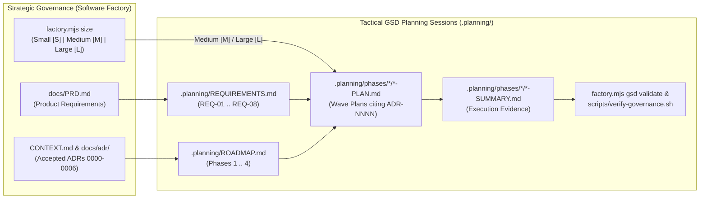

# Product Requirements Document (PRD): ADR-Governed Software Factory & GSD Engine

- **Document ID**: `PRD-0001`
- **Status**: `approved` (Reverse-Engineered Baseline `v1.0.0`)
- **Last Updated**: 2026-11-03
- **Governing ADRs**: `ADR-0000`, `ADR-0001`, `ADR-0002`, `ADR-0003`, `ADR-0004`, `ADR-0005`, `ADR-0006`
- **Governing RFC**: [`RFC-0001`](./rfc/RFC-0001-executable-software-factory-engine.md)
- **GSD Planning Spine**: [`.planning/PROJECT.md`](../.planning/PROJECT.md), [`.planning/REQUIREMENTS.md`](../.planning/REQUIREMENTS.md), [`.planning/ROADMAP.md`](../.planning/ROADMAP.md), [`.planning/STATE.md`](../.planning/STATE.md)

---

## 1. Executive Summary & Problem Statement

### 1.1 Problem Statement
As engineering organizations scale AI-assisted development across **VS Code GitHub Copilot**, **Claude Code**, **Antigravity**, the **GSD (Get Shit Done) Framework**, and **Atlassian MCPs** (**Jira**, **Confluence**, **Bitbucket**), two failure modes emerge:
1. **Unchecked Architectural Drift & Zombie Code**: Coding agents introduce unauthorized libraries, bypass module boundaries (`lib/` or `internal/` imports), recreate intentionally deleted patterns, or execute GSD phase plans (`.planning/phases/*/*-PLAN.md`) without linking to accepted Architectural Decision Records (ADRs).
2. **One-Size-Fits-All Ceremony Bottlenecks**: Applying heavy architectural research, Confluence MCP queries, and multi-phase GSD roadmapping to trivial UI/copy tweaks (e.g., changing a button color) slows developers down, while relying purely on markdown prompt instructions without deterministic CLI enforcement leads to inconsistent compliance.

### 1.2 Product Vision
Provide a **zero-dependency, executable ADR-Governed Software Factory** that:
- Dynamically routes tasks via **Adaptive Agent Sizing (`Small [S]` | `Medium [M]` | `Large [L]`)** so trivial tweaks complete in seconds (`Small [S]` / `/quick` / `/gsd-quick`), standard features execute through 4-Gate Vertical Tracer-Bullet TDD (`Medium [M]`), and architectural changes halt for formal ADR/RFC approval (`Large [L]`).
- Deterministically enforces **Deep Module seams**, **Structural Drift gates**, **Confluence <-> Local ADR Parity**, **Delete-Zone rules**, and **GSD `.planning/` ADR traceability** in `< 500ms`.
- Automates **Two-Axis Separate-Context PR Reviews** and **Merge Danger** (`One-Way Door` vs. `Two-Way Door` + `Blast Radius`) scoring.

---

## 2. Target Users & Personas

| Persona | Primary Agent / Entry Point | Core Jobs-to-be-Done (JTBD) | Key Pain Points Solved |
| :--- | :--- | :--- | :--- |
| **New / Onboarding Engineer** | `@onboarding` ([`.github/agents/onboarding.agent.md`](../.github/agents/onboarding.agent.md)), `/onboard` | Understand system boundaries, ubiquitous domain terms, active ADRs, and in-progress Jira/GSD work without reading stale wiki pages. | Eliminates tribal knowledge gaps via visual `/show-me` tours backed by [`CONTEXT.md`](../CONTEXT.md) and [`GLOSSARY.md`](../GLOSSARY.md). |
| **Feature Engineer** | `@engineer` ([`.github/agents/engineer.agent.md`](../.github/agents/engineer.agent.md)), `/quick`, `/start`, `/feature-spec`, `/gsd-execute-phase` | Ship trivial fixes (`[S]`) immediately and build complex features (`[M]`/`[L]`) via Vertical Tracer-Bullet TDD without breaking architecture rules. | Skips ceremony on small tweaks; prevents PR rejections via fast `< 500ms` local verification (`verify-governance.sh`). |
| **Staff / Principal Architect** | `@architect` ([`.github/agents/architect.agent.md`](../.github/agents/architect.agent.md)), `/create-adr`, `/create-rfc` | Stress-test hard-to-reverse decisions (`grill-with-docs`), publish ADRs/RFCs to Confluence, maintain local parity, and decompose RFCs into Jira Tracer-Bullet DAGs. | Prevents undocumented dependencies, schema changes, or cross-module leaks from landing without an approved ADR/RFC. |
| **Code Reviewer / Tech Lead** | `@pr-reviewer` ([`.github/agents/pr-reviewer.agent.md`](../.github/agents/pr-reviewer.agent.md)), `/two-axis-review`, `/visual-pr`, `/retro` | Audit code in an isolated context against [`CODING_STANDARDS.md`](../CODING_STANDARDS.md) (Axis 1) and Jira Spec fidelity (Axis 2), assess Merge Danger, and codify review comments into permanent rules. | Eliminates repetitive review comments and flags `One-Way Door` changes requiring architect sign-off. |

---

## 3. Alignment with GSD Planning Sessions (`.planning/` <-> Software Factory)

This PRD serves as the **product requirements spine** connecting strategic governance ([`CONTEXT.md`](../CONTEXT.md), [`docs/adr/`](./adr/)) with tactical **GSD Planning Sessions** ([`.planning/`](../.planning/), governed by [`ADR-0006`](./adr/0006-gsd-native-execution-bridge.md) and [`docs/agents/gsd-integration.md`](./agents/gsd-integration.md)).

### 3.1 How GSD Planning Sessions Map to This PRD

### 3.2 End-to-End GSD Session Lifecycle & Governance Gates

| GSD Session Stage | Command / Trigger | Artifacts Read / Updated | Software Factory Governance Gate |
| :--- | :--- | :--- | :--- |
| **1. Fast-Track Bypass (`Small [S]`)** | `/quick` or `/gsd-quick` | Target source file (`<= 2` files) | `node src/cli/factory.mjs size` confirms `Small [S]`; skips `.planning/` phase ceremony and runs `./scripts/verify-governance.sh`. |
| **2. Milestone & Requirement Sync** | `/gsd-new-milestone` | `docs/PRD.md` -> `.planning/PROJECT.md`, `.planning/REQUIREMENTS.md`, `.planning/ROADMAP.md` | Every phase in `ROADMAP.md` must cite at least one `accepted` `ADR-NNNN` from `CONTEXT.md`. |
| **3. Phase Discussion & ADR Gate** | `/gsd-discuss-phase <N>` | `CONTEXT.md`, `GLOSSARY.md`, `docs/adr/` | If phase requires a new library, DB schema, or contract outside accepted ADRs (`Large [L]`), **HARD STOP** -> run `@architect` (`/create-adr` or `/create-rfc`) before planning. |
| **4. Phase Wave Planning** | `/gsd-plan-phase <N>` | `.planning/phases/<N>/*-PLAN.md` | `node src/cli/factory.mjs gsd validate` verifies that every `*-PLAN.md` cites valid `accepted` ADRs and targets public Deep Module seams (`src/modules/<domain>/index.mjs`). |
| **5. Phase Execution (Seam TDD)** | `/gsd-execute-phase <N>` | `src/modules/*`, `tests/*.seam.test.mjs`, `*-SUMMARY.md` | Red-Green-Refactor TDD at the module's public `index.mjs` seam; `gsd-tools.cjs state-snapshot` updates `.planning/STATE.md`. |
| **6. Work Verification & Ship** | `/gsd-verify-work` / `/gsd-ship` | `.planning/config.json`, `*-VERIFICATION.md` | Automatically runs `workflow.code_review_command` (`./scripts/verify-governance.sh`), then hands off to `@pr-reviewer` (`/two-axis-review` + `/visual-pr`). |

### 3.3 Traceability Matrix: PRD <-> GSD `.planning/` Phases <-> ADRs

| GSD Phase | GSD Requirement IDs (`.planning/REQUIREMENTS.md`) | PRD Functional Requirements | Governing ADRs | GSD Phase Plan & Summary | Verification Test Suite |
| :--- | :--- | :--- | :--- | :--- | :--- |
| **Phase 1: Adaptive Agent Sizing Engine** | `REQ-01`, `REQ-02` | `FR-SIZE-01` .. `FR-SIZE-05` | `ADR-0001`, `ADR-0002` | [`01-01-PLAN.md`](../.planning/phases/01-adaptive-agent-sizing-engine/01-01-PLAN.md) / [`01-01-SUMMARY.md`](../.planning/phases/01-adaptive-agent-sizing-engine/01-01-SUMMARY.md) | [`tests/sizing.seam.test.mjs`](../tests/sizing.seam.test.mjs) |
| **Phase 2: Governance, Seam & ADR Parity Engine** | `REQ-03`, `REQ-04` | `FR-GOV-01` .. `FR-GOV-04` | `ADR-0001`, `ADR-0003`, `ADR-0004` | [`02-01-PLAN.md`](../.planning/phases/02-governance-seam-adr-parity-engine/02-01-PLAN.md) / [`02-01-SUMMARY.md`](../.planning/phases/02-governance-seam-adr-parity-engine/02-01-SUMMARY.md) | [`tests/governance.seam.test.mjs`](../tests/governance.seam.test.mjs) |
| **Phase 3: Two-Axis Review & Merge Danger Engine** | `REQ-05`, `REQ-06` | `FR-REV-01` .. `FR-REV-04` | `ADR-0001`, `ADR-0005` | [`03-01-PLAN.md`](../.planning/phases/03-two-axis-review-merge-danger-engine/03-01-PLAN.md) / [`03-01-SUMMARY.md`](../.planning/phases/03-two-axis-review-merge-danger-engine/03-01-SUMMARY.md) | [`tests/review.seam.test.mjs`](../tests/review.seam.test.mjs) |
| **Phase 4: Native GSD Framework Bridge & CLI** | `REQ-07`, `REQ-08` | `FR-GSD-01` .. `FR-GSD-04`, `FR-CLI-01` .. `FR-CLI-04` | `ADR-0001`, `ADR-0006` | [`04-01-PLAN.md`](../.planning/phases/04-native-gsd-framework-bridge-cli/04-01-PLAN.md) / [`04-01-SUMMARY.md`](../.planning/phases/04-native-gsd-framework-bridge-cli/04-01-SUMMARY.md) | [`tests/gsd.seam.test.mjs`](../tests/gsd.seam.test.mjs), [`tests/cli.integration.test.mjs`](../tests/cli.integration.test.mjs) |

---

## 4. Functional Requirements (Reverse-Engineered by Subsystem)

### 4.1 Subsystem 1: Adaptive Agent Sizing Engine (`src/modules/sizing/`)
- **Governing ADRs**: [`ADR-0001`](./adr/0001-deep-module-boundaries.md), [`ADR-0002`](./adr/0002-adaptive-agent-sizing-classifier.md)
- **Public Seam**: [`src/modules/sizing/index.mjs`](../src/modules/sizing/index.mjs) (`classifyTaskSize`)
- **Private Implementation**: [`src/modules/sizing/lib/classifier.mjs`](../src/modules/sizing/lib/classifier.mjs)

| Req ID | GSD Req | Requirement Name | Detailed Specification |
| :--- | :--- | :--- | :--- |
| **FR-SIZE-01** | `REQ-01`, `REQ-02` | **Dual-Mode Size Selection** | Support both **User-Explicit Override** (`[S]`, `[M]`, `[L]`, `--small`, `--medium`, `--large`, `size:small\|medium\|large`, `/quick` in prompt or `explicitSize` parameter) and **Auto-Detection Mode** when no flag is provided. |
| **FR-SIZE-02** | `REQ-01` | **Small `[S]` Fast-Track Detection** | In auto-detect mode, if `changedFiles.length <= 2`, no structural files are touched, and the prompt matches UI/copy/constant keywords (`button color`, `change color`, `color of`, `typo`, `spelling`, `copy tweak`, `tooltip`, `padding`, `margin`, `font-size`, `css`, `style tweak`, `rename label`, `constant`, `timeout value`), classify as `Small [S]` with `skipResearch: true`, `skipConfluenceMcp: true`, `skipShowMe: true`, and `requiredGates: ['local-verify']`. |
| **FR-SIZE-03** | `REQ-01` | **Large `[L]` Architectural Escalation** | In auto-detect mode, if any touched file matches structural patterns (`package.json`, `requirements.txt`, `pyproject.toml`, `pom.xml`, `build.gradle`, `go.mod`, `Cargo.toml`, `migrations/`, `schema/`, `prisma/`, `db/migrate/`, `*.sql`, `docs/adr/`, `docs/rfc/`) OR the prompt contains architectural keywords (`new library/dependency/package/database/table/schema/migration/module/microservice`, `migrate to`, `redis`, `kafka`, `graphql`, `cross-module`, `rfc`, `create-adr`, `create-rfc`, `breaking change`), classify as `Large [L]` with `hardStopForAdrOrRfc: true` and `requiredGates: ['product', 'architecture-adr-rfc-hard-stop', 'program-design', 'tdd']`. |
| **FR-SIZE-04** | `REQ-01` | **Medium `[M]` Default 4-Gate Routing** | Tasks that do not match `Small [S]` or `Large [L]` default to `Medium [M]` with `requiredGates: ['product', 'architecture', 'program-design', 'tdd']`. |
| **FR-SIZE-05** | `REQ-02` | **Mandatory Safety Escalation Guard** | If a user explicitly requests `Small [S]` (e.g., `/quick` or `--size S`) while modifying any structural/architectural file (manifests, migrations, SQL, or `docs/adr\|rfc/`), override the user request, escalate to `Large [L]` (`mode: 'safety-escalated'`, `escalated: true`), and populate `escalationReason`. |

---

### 4.2 Subsystem 2: Governance, Seam & ADR Parity Engine (`src/modules/governance/`)
- **Governing ADRs**: [`ADR-0001`](./adr/0001-deep-module-boundaries.md), [`ADR-0003`](./adr/0003-hybrid-adr-confluence-sync.md), [`ADR-0004`](./adr/0004-deterministic-governance-cli.md)
- **Public Seam**: [`src/modules/governance/index.mjs`](../src/modules/governance/index.mjs) (`verifyGovernance`, `parseAdrRegistry`)
- **Private Implementation**: [`seam-checker.mjs`](../src/modules/governance/lib/seam-checker.mjs), [`drift-checker.mjs`](../src/modules/governance/lib/drift-checker.mjs), [`adr-registry-parser.mjs`](../src/modules/governance/lib/adr-registry-parser.mjs)

| Req ID | GSD Req | Requirement Name | Detailed Specification |
| :--- | :--- | :--- | :--- |
| **FR-GOV-01** | `REQ-03` | **Deep Module Seam Boundary Enforcement** | Scan changed code files (`.mjs`, `.cjs`, `.js`, `.ts`, `.tsx`, `.jsx`, `.py`, `.go`, `.java`) for static or dynamic `import`/`export` statements. Flag a **Seam Violation** whenever: (a) a test file (`tests/*` or `*.test.*`) imports from `/lib/` or `/internal/`, or (b) any code file uses parent traversal (`../`), package aliases (`@`), or `src/modules/` paths to reach into another module's `/lib/` or `/internal/`. Intra-module `./lib/` or `./internal/` imports from a module's own `index.*` are permitted. |
| **FR-GOV-02** | `REQ-04` | **Structural Drift Documentation Gate** | When any structural manifest or schema file (`package.json`, `requirements.txt`, `pyproject.toml`, `pom.xml`, `build.gradle`, `go.mod`, `Cargo.toml`, `schema.prisma`, `migrations/`, `db/migrate/`, `*.sql`) is modified, at least one governance document (`CONTEXT.md`, `GLOSSARY.md`, `docs/adr/*.md`, or `docs/rfc/*.md`) MUST be updated in the same change set. Otherwise, fail with a `[Structural Drift]` violation. |
| **FR-GOV-03** | `REQ-04` | **1:1 ADR Registry Parity** | Parse the Canonical ADR Registry table in `CONTEXT.md` Section 3. For every row with status `accepted`, verify that its `docs/adr/*.md` local mirror file exists on disk AND is indexed in `docs/adr/README.md`. |
| **FR-GOV-04** | `REQ-03` | **Delete-Zone Anti-Zombie Guard** | Prevent recreation of banned patterns registered in `CONTEXT.md` Section 5. Specifically, reject any module root entry point (`src/modules/<domain>/index.*`) that uses barrel re-exports (`export * from './lib/...'` or `export * from './internal/...'`). |

---

### 4.3 Subsystem 3: Two-Axis Review & Merge Danger Engine (`src/modules/review/`)
- **Governing ADRs**: [`ADR-0001`](./adr/0001-deep-module-boundaries.md), [`ADR-0005`](./adr/0005-two-axis-review-and-merge-danger.md)
- **Public Seam**: [`src/modules/review/index.mjs`](../src/modules/review/index.mjs) (`assessMergeDanger`, `generateVisualPrBody`)
- **Private Implementation**: [`merge-danger.mjs`](../src/modules/review/lib/merge-danger.mjs), [`visual-pr-formatter.mjs`](../src/modules/review/lib/visual-pr-formatter.mjs)

| Req ID | GSD Req | Requirement Name | Detailed Specification |
| :--- | :--- | :--- | :--- |
| **FR-REV-01** | `REQ-05` | **Door Classification (`One-Way` vs. `Two-Way Door`)** | Classify a change set as a **`One-Way Door`** if it modifies DB schemas/migrations/`*.sql`, alters package manifests (`package.json`, `requirements.txt`, `pom.xml`, `go.mod`), adds/modifies `docs/adr/` or `docs/rfc/`, touches `src/auth/` or `src/security/`, contains destructive SQL statements (`DROP TABLE`, `DROP COLUMN`, `TRUNCATE TABLE`, `ALTER TABLE`) in `diffText`, or sets `hasNewAdrOrRfc: true`. Otherwise classify as **`Two-Way Door`**. |
| **FR-REV-02** | `REQ-05` | **Blast Radius Scoring** | Classify `blastRadius` as: (a) **`System-Wide`** if any root governance/config file (`CONTEXT.md`, `GLOSSARY.md`, `CODING_STANDARDS.md`, `AGENTS.md`, `package.json`, `.github/*`), migration directory, or `> 1` distinct `src/modules/<domain>/` module is touched; (b) **`Module-Wide`** if `> 2` files are touched within a single module; or (c) **`Localized`** if `<= 2` non-root files within a single module are touched. |
| **FR-REV-03** | `REQ-05` | **Architect Sign-Off Flag** | Set `requiresArchitectSignOff: true` whenever `door === 'One-Way Door'` OR `blastRadius === 'System-Wide'`. |
| **FR-REV-04** | `REQ-06` | **`/visual-pr` Markdown Generator** | Generate a standardized Bitbucket/GitHub PR description containing: (1) Jira Ticket & Governing ADR badges, (2) Structural Visual Diff (`/show-me` file tree), (3) Merge Danger Assessment table & rationale, (4) Two-Axis Separate-Context Review verdict table (Axis 1: Standards & ADR Compliance; Axis 2: Jira Spec Fidelity), and (5) Before/After verification evidence. |

---

### 4.4 Subsystem 4: Native GSD Framework Bridge (`src/modules/gsd/`)
- **Governing ADRs**: [`ADR-0001`](./adr/0001-deep-module-boundaries.md), [`ADR-0006`](./adr/0006-gsd-native-execution-bridge.md)
- **Public Seam**: [`src/modules/gsd/index.mjs`](../src/modules/gsd/index.mjs) (`resolveGsdPaths`, `validatePlanningAdrAlignment`, `inspectGsdWorkspace`)
- **Private Implementation**: [`gsd-bridge.mjs`](../src/modules/gsd/lib/gsd-bridge.mjs)

| Req ID | GSD Req | Requirement Name | Detailed Specification |
| :--- | :--- | :--- | :--- |
| **FR-GSD-01** | `REQ-07` | **Multi-Path GSD Core Resolution** | Resolve `gsd-tools.cjs` across explicit `options.gsdCoreDir`, `$GSD_CORE_DIR`, `~/.gemini/antigravity/gsd-core`, `~/.claude/get-shit-done`, and `~/.codex/get-shit-done`, with automatic fallback parsing (`fallback-parser` mode) when the binary is absent. |
| **FR-GSD-02** | `REQ-07` | **Tactical State Delegation** | When `.planning/` is initialized and `gsd-tools.cjs` is installed, invoke `gsd-tools.cjs roadmap analyze` and `gsd-tools.cjs state-snapshot` rather than duplicating GSD state parsing. |
| **FR-GSD-03** | `REQ-07` | **Roadmap & Phase Plan ADR Traceability** | Parse `.planning/ROADMAP.md` (`### Phase <N>: <Name>` sections) and all `.planning/phases/*/*-PLAN.md` files. Verify that every roadmap phase and every phase plan cites at least one `ADR-NNNN` identifier, and that every cited ADR is `accepted` in `CONTEXT.md`. |
| **FR-GSD-04** | `REQ-08` | **Automated GSD Code Review Hook** | Wire `.planning/config.json` with `"code_review_command": "./scripts/verify-governance.sh"` and `"claude_md_path": "./AGENTS.md"` so `/gsd-verify-work` deterministically runs the Software Factory gate. |

---

### 4.5 Subsystem 5: CLI, Repository Bootstrap & Multi-Agent Ecosystem
- **Governing ADRs**: [`ADR-0000`](./adr/0000-adr-driven-software-factory.md), [`ADR-0004`](./adr/0004-deterministic-governance-cli.md), [`ADR-0006`](./adr/0006-gsd-native-execution-bridge.md)
- **Entry Points**: [`src/cli/factory.mjs`](../src/cli/factory.mjs), [`scripts/factory-init.sh`](../scripts/factory-init.sh), [`scripts/verify-governance.sh`](../scripts/verify-governance.sh), [`bitbucket-pipelines.yml`](../bitbucket-pipelines.yml)

| Req ID | GSD Req | Requirement Name | Detailed Specification |
| :--- | :--- | :--- | :--- |
| **FR-CLI-01** | `REQ-08` | **Unified `factory.mjs` CLI** | Provide four subcommands in `src/cli/factory.mjs`: `size`, `verify`, `pr-report`, and `gsd <status\|validate>`, supporting `--files`, `--size`, and `--json` flags with non-zero exit codes on governance failures. |
| **FR-CLI-02** | `REQ-08` | **One-Command Target Repo Bootstrap** | `scripts/factory-init.sh` initializes any target repository by copying `.github/agents/`, `.github/prompts/`, `.vscode/settings.json`, `src/`, and `scripts/`, seeding missing living governance docs (`CONTEXT.md`, `GLOSSARY.md`, `CODING_STANDARDS.md`, `AGENTS.md`, `CLAUDE.md`, `bitbucket-pipelines.yml`), and configuring `.planning/config.json`. |
| **FR-CLI-03** | `REQ-04` | **Local Git Hooks & CI Enforcement** | Install a `commit-msg` hook that auto-injects the Jira key (`[A-Z][A-Z0-9]+-[0-9]+`) from the active branch name into commit messages, a `pre-push` hook that runs `./scripts/verify-governance.sh --pre-push`, and a server-side pipeline in `bitbucket-pipelines.yml`. |
| **FR-CLI-04** | `REQ-01` | **Persona Agents, Prompts & 43 Skills** | Ship 4 specialized Copilot agents (`@onboarding`, `@architect`, `@engineer`, `@pr-reviewer`), 9 slash prompts (`/start`, `/quick`, `/onboard`, `/feature-spec`, `/create-adr`, `/create-rfc`, `/two-axis-review`, `/visual-pr`, `/retro`), and 43 reusable skills in `.agents/skills/`. |

---

## 5. Non-Functional Requirements (NFRs)

| Category | Requirement ID | Specification & Target Metric |
| :--- | :--- | :--- |
| **Zero External Dependencies** | **NFR-01** | The runtime CLI and all Deep Modules MUST execute using pure Node.js built-in ESM modules (`node:fs`, `node:path`, `node:child_process`, `node:os`, `node:test`, `node:assert`) with **zero `npm` runtime dependencies** in [`package.json`](../package.json). |
| **Performance & Latency** | **NFR-02** | `factory.mjs verify` and `./scripts/verify-governance.sh` MUST complete in **`< 500ms`** locally, and the full 5-file seam/integration test suite (`npm test`) MUST execute in **`< 500ms`**. |
| **Immutability & Purity** | **NFR-03** | All public seam return values across `sizing`, `governance`, `review`, and `gsd` MUST be deeply frozen (`Object.freeze`) to prevent callers from mutating governance verdicts ([`CODING_STANDARDS.md`](../CODING_STANDARDS.md)). |
| **Graceful Degradation** | **NFR-04** | If Node.js is absent, `scripts/verify-governance.sh` falls back cleanly; if `gsd-tools.cjs` is absent, `inspectGsdWorkspace` falls back to `fallbackRoadmapAnalyze`. |
| **Cross-Harness Portability** | **NFR-05** | Governance rules must work identically across VS Code GitHub Copilot (`.github/copilot-instructions.md`), Claude Code ([`CLAUDE.md`](../CLAUDE.md)), and Antigravity/Codex ([`AGENTS.md`](../AGENTS.md)). |
