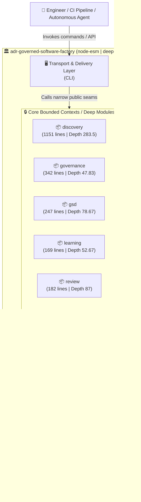
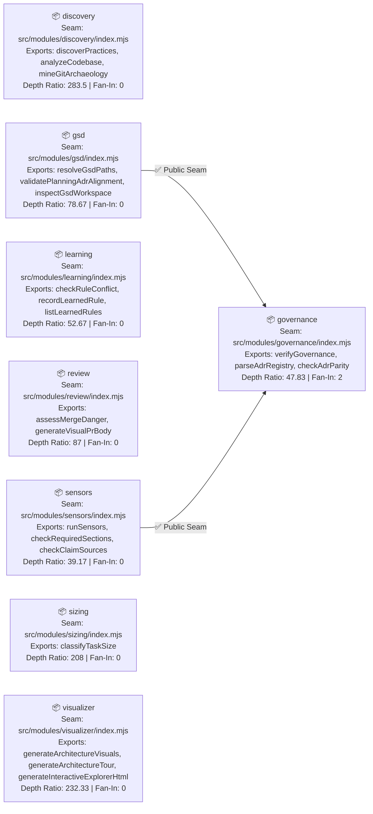
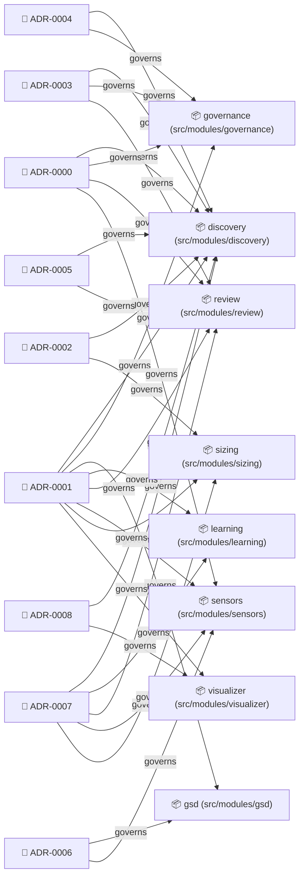
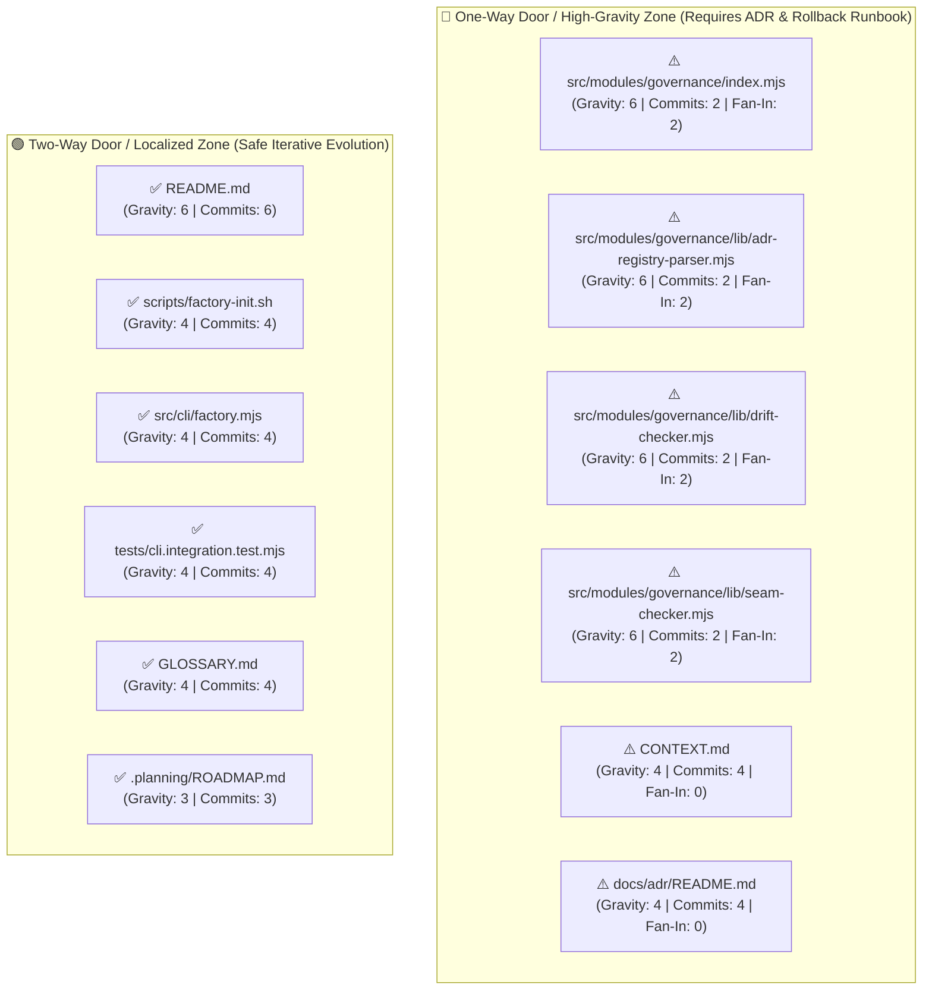
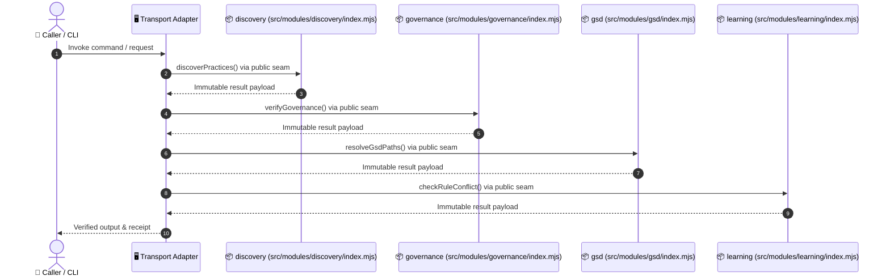

# Visual Architecture Blueprint: `adr-governed-software-factory`

> **Generated by Software Factory Visual Intelligence Engine (`ADR-0008`)**
> - **Runtime**: `node-esm` | **Test Runner**: `node:test` | **Layout**: `deep-modules`
> - **Scale**: `33` code files (`4753` lines) across `8` bounded module(s)
> - **Seam Health**: `0` seam violation(s), `0` circular dependency cycle(s)

---

## Lens 1: C4 System Context & Container Architecture

---

## Lens 2: Deep Module Seam & Dependency Topology

### Module Depth & Coupling Metrics Table

| Module | Public Entry Point | Exported Symbols | Total Lines | Hidden Lines | Depth Ratio | Fan-In | Fan-Out | Instability ($I$) | Governing ADRs |
| :--- | :--- | :--- | :--- | :--- | :--- | :--- | :--- | :--- | :--- |
| **`discovery`** | `src/modules/discovery/index.mjs` | `discoverPractices, analyzeCodebase, mineGitArchaeology, synthesizeRetroAdrs` | 1151 | 1134 | **283.5** | 0 | 0 | 0 | `ADR-0000`, `ADR-0001`, `ADR-0002`, `ADR-0003`, `ADR-0004`, `ADR-0005`, `ADR-0007`, `ADR-0008` |
| **`governance`** | `src/modules/governance/index.mjs` | `verifyGovernance, parseAdrRegistry, checkAdrParity, checkSeamViolations, checkStructuralDrift, checkDeleteZoneViolations` | 342 | 287 | **47.83** | 2 | 0 | 0 | `ADR-0000`, `ADR-0001`, `ADR-0003`, `ADR-0004` |
| **`gsd`** | `src/modules/gsd/index.mjs` | `resolveGsdPaths, validatePlanningAdrAlignment, inspectGsdWorkspace` | 247 | 236 | **78.67** | 0 | 1 | 1 | `ADR-0001`, `ADR-0006` |
| **`learning`** | `src/modules/learning/index.mjs` | `checkRuleConflict, recordLearnedRule, listLearnedRules` | 169 | 158 | **52.67** | 0 | 0 | 0 | `ADR-0001`, `ADR-0007` |
| **`review`** | `src/modules/review/index.mjs` | `assessMergeDanger, generateVisualPrBody` | 182 | 174 | **87** | 0 | 0 | 0 | `ADR-0000`, `ADR-0001`, `ADR-0003`, `ADR-0005`, `ADR-0007` |
| **`sensors`** | `src/modules/sensors/index.mjs` | `runSensors, checkRequiredSections, checkClaimSources, checkTraceability, emitVerificationReceipt, checkVerificationReceipt` | 249 | 235 | **39.17** | 0 | 1 | 1 | `ADR-0000`, `ADR-0001`, `ADR-0006`, `ADR-0007` |
| **`sizing`** | `src/modules/sizing/index.mjs` | `classifyTaskSize` | 215 | 208 | **208** | 0 | 0 | 0 | `ADR-0001`, `ADR-0002`, `ADR-0007` |
| **`visualizer`** | `src/modules/visualizer/index.mjs` | `generateArchitectureVisuals, generateArchitectureTour, generateInteractiveExplorerHtml` | 712 | 697 | **232.33** | 0 | 0 | 0 | `ADR-0001`, `ADR-0008` |

---

## Lens 3: ADR Governance Coverage Matrix

### Synthesized Retro-ADR Status Summary

| ADR ID | Title | Dimension | Status | Adherence |
| :--- | :--- | :--- | :--- | :--- |
| **`ADR-0001`** | Standardize on NODE-ESM Runtime and deep-modules Layout | `runtime-and-modules` | `accepted` | 100% |
| **`ADR-0002`** | Enforce Deep Module Public Seams and Prohibit Cross-Module Internal Imports | `boundary-encapsulation` | `accepted` | 100% |
| **`ADR-0003`** | File-Backed Living Documents & Deterministic JSON State Persistence | `persistence-and-state` | `accepted` | 100% |
| **`ADR-0004`** | Expose Capabilities via CLI Transport Adapter | `api-and-transport` | `accepted` | 100% |
| **`ADR-0005`** | Enforce Public Seam Testing via node:test and Automated CI Gates | `verification-and-ci` | `accepted` | 100% |

---

## Lens 4: Git Churn vs. Architectural Gravity Risk Quadrant

---

## Lens 5: End-to-End Execution Call Tree

