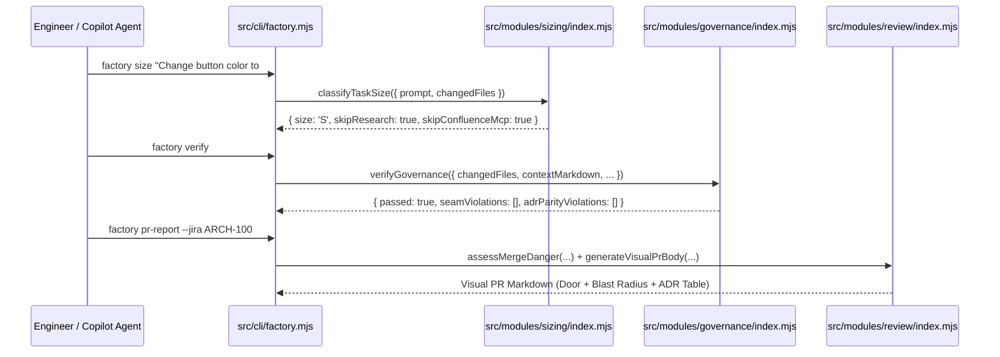

# RFC-0001: Executable ADR-Governed Software Factory Engine & CLI

- **Date**: 2026-11-02
- **Status**: `approved`
- **Authors / Architects**: Principal Engineering & Architecture Team
- **Confluence Page**: `CONF-RFC-0001` (`https://your-org.atlassian.net/wiki/spaces/ARCH/pages/RFC-0001`)
- **Parent Jira Epic**: `ARCH-100`
- **Impacted Modules (`CONTEXT.md`)**: `src/modules/sizing/`, `src/modules/governance/`, `src/modules/review/`, `src/cli/factory.mjs`, `scripts/verify-governance.sh`
- **Impacted / Governing ADRs**: `ADR-0000`, `ADR-0001`, `ADR-0002`, `ADR-0003`, `ADR-0004`, `ADR-0005`

---

## 1. Executive Summary & Problem Statement

- **Problem to Solve**: To scale AI-assisted development across engineers and architects using VS Code Copilot, Jira MCP, Confluence MCP, and Bitbucket MCP, governance cannot rely solely on markdown prompts. Engineers need an executable **Software Factory Engine** that deterministically classifies task size (`Small [S]` | `Medium [M]` | `Large [L]`), enforces **Deep Module** seams and **ADR Parity** in `< 500ms`, and generates **Two-Axis `/visual-pr` Merge Danger** reports.
- **What Success Looks Like**:
  1. `node src/cli/factory.mjs size "<task>"` accurately routes `Small [S]` tasks (e.g., changing a button color) to a zero-research fast-track while escalating `Large [L]` tasks (new libraries, DB migrations, ADR drift) to a Hard Stop for ADR/RFC creation.
  2. `node src/cli/factory.mjs verify` (and `./scripts/verify-governance.sh`) enforces Deep Module seam encapsulation, Structural Drift documentation gates, `CONTEXT.md` <-> `docs/adr/` ADR Parity, and Delete-Zone rules.
  3. `node src/cli/factory.mjs pr-report` computes `One-Way Door` vs. `Two-Way Door` **Merge Danger** and outputs a ready-to-publish Bitbucket `/visual-pr` description.
- **Why an RFC (Not a Single ADR)**: This initiative spans three distinct **Deep Modules** (`sizing`, `governance`, `review`), the CLI entry point (`src/cli/factory.mjs`), and the repository's pre-push/CI automation pipeline.

---

## 2. System Architecture & Visual Outline (`/show-me`)

### 2.1 High-Level Runtime Control Flow


### 2.2 File-Tree Diff
```diff
 software-factory/
+├── package.json                                  # Zero-dependency ESM package & npm test/factory scripts
+├── src/
+│   ├── cli/
+│   │   └── factory.mjs                           # CLI adapter (size | verify | pr-report)
+│   └── modules/
+│       ├── sizing/
+│       │   ├── index.mjs                         # Public Seam: classifyTaskSize
+│       │   └── lib/
+│       │       └── classifier.mjs                # Private implementation (S/M/L + Safety Escalation)
+│       ├── governance/
+│       │   ├── index.mjs                         # Public Seam: verifyGovernance, parseAdrRegistry
+│       │   └── lib/
+│       │       ├── adr-registry-parser.mjs       # Private CONTEXT.md & docs/adr/ parity parser
+│       │       ├── drift-checker.mjs             # Private structural drift & delete-zone checker
+│       │       └── seam-checker.mjs              # Private cross-module /lib/ import detector
+│       └── review/
+│           ├── index.mjs                         # Public Seam: assessMergeDanger, generateVisualPrBody
+│           └── lib/
+│               ├── merge-danger.mjs              # Private 1-Way/2-Way Door & Blast Radius scorer
+│               └── visual-pr-formatter.mjs       # Private /visual-pr markdown builder
+└── tests/
+    ├── sizing.seam.test.mjs                      # Tracer-Bullet 1 Seam Tests
+    ├── governance.seam.test.mjs                  # Tracer-Bullet 2 Seam Tests
+    ├── review.seam.test.mjs                      # Tracer-Bullet 3 Seam Tests
+    └── cli.integration.test.mjs                  # Tracer-Bullet 4 End-to-End CLI Tests
```

---

## 3. Program Design (Interfaces & Signatures Without Bodies)

```js
// Seam 1: src/modules/sizing/index.mjs (Governed by ADR-0001, ADR-0002)
export function classifyTaskSize({ prompt, changedFiles = [], explicitSize = null }) {}

// Seam 2: src/modules/governance/index.mjs (Governed by ADR-0001, ADR-0003, ADR-0004)
export function parseAdrRegistry(contextMarkdown) {}
export function verifyGovernance({
  changedFiles = [],
  fileContents = {},
  contextMarkdown = '',
  adrReadmeMarkdown = '',
  existingAdrFiles = [],
}) {}

// Seam 3: src/modules/review/index.mjs (Governed by ADR-0001, ADR-0005)
export function assessMergeDanger({ changedFiles = [], diffText = '', hasNewAdrOrRfc = false }) {}
export function generateVisualPrBody({
  title,
  jiraKey = 'UNSPECIFIED',
  adrIds = ['ADR-0000'],
  changedFiles = [],
  beforeEvidence = 'Previous state prior to change',
  afterEvidence = 'All seam tests and governance gates passing',
  standardsPassed = true,
  specPassed = true,
}) {}
```

---

## 4. Migration, Rollout & Merge Danger Strategy

- **Door Classification**: `Two-Way Door` (new self-contained Deep Modules and CLI that upgrade `./scripts/verify-governance.sh` while maintaining full backward compatibility).
- **Rollout Strategy**: Build in 4 sequential **Vertical Tracer Bullets** with Red-Green-Refactor TDD at each module's public `index.mjs` seam.
- **Rollback Plan**: Revert commit or fall back to pure shell checks in `scripts/verify-governance.sh`.

---

## 5. Tracer-Bullet Work Units DAG (`to-tickets` + `ralphinho-rfc-pipeline`)

| Unit ID | Jira Key | Title (End-to-End Behavior) | Depends On (`Blocked By`) | Execution Size | Acceptance Tests at Seam |
|---|---|---|---|---|---|
| `UNIT-01` | `ARCH-101` | **Tracer Bullet 1**: `sizing` Deep Module (`classifyTaskSize` with `Small`/`Medium`/`Large` + Safety Escalation) | `None` | `Medium [M]` | `tests/sizing.seam.test.mjs` |
| `UNIT-02` | `ARCH-102` | **Tracer Bullet 2**: `governance` Deep Module (`verifyGovernance` for Seam Violations, Drift, ADR Parity & Delete-Zone) | `UNIT-01` | `Medium [M]` | `tests/governance.seam.test.mjs` |
| `UNIT-03` | `ARCH-103` | **Tracer Bullet 3**: `review` Deep Module (`assessMergeDanger` & `generateVisualPrBody`) | `UNIT-01` | `Medium [M]` | `tests/review.seam.test.mjs` |
| `UNIT-04` | `ARCH-104` | **Tracer Bullet 4**: `factory` CLI (`src/cli/factory.mjs`) & `./scripts/verify-governance.sh` Integration | `UNIT-02`, `UNIT-03` | `Medium [M]` | `tests/cli.integration.test.mjs` |
