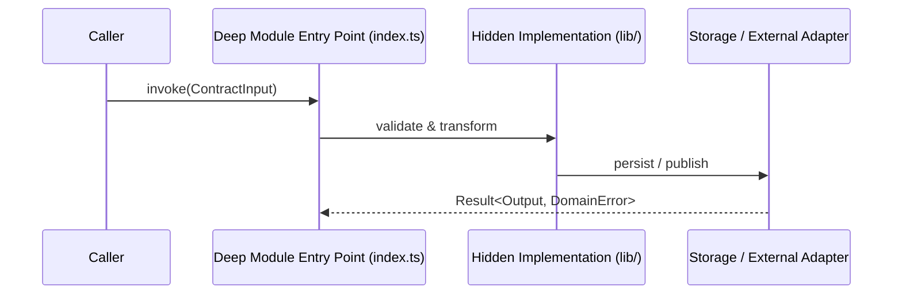

# RFC-NNNN: [Title of Cross-Cutting Feature or Architecture Evolution]

- **Date**: YYYY-MM-DD
- **Status**: `draft` | `in-review` | `approved` | `implementing` | `completed`
- **Authors / Architects**: [Names]
- **Confluence Page**: `[CONF-RFC-ID](https://your-org.atlassian.net/wiki/spaces/ARCH/pages/...)`
- **Parent Jira Epic**: `[PROJ-XXXX](https://your-org.atlassian.net/browse/PROJ-XXXX)`
- **Impacted Modules (`CONTEXT.md`)**: `src/modules/...`
- **Impacted / Superseded ADRs**: `ADR-NNNN`

---

## 1. Executive Summary & Problem Statement

- **Problem to Solve**: [User or system pain in clear domain terms from `GLOSSARY.md`]
- **What Success Looks Like**: [Measurable user or system outcome]
- **Why an RFC (Not a Single ADR)**: [Explain the cross-cutting scope, multi-module impact, or migration complexity]

---

## 2. System Architecture & Visual Outline (`/show-me`)

### 2.1 High-Level Data & Control Flow


### 2.2 File-Tree Diff
```diff
 src/modules/<domain>/
~├── index.ts                # Public Deep Module Interface
+├── lib/new-capability.ts   # Private implementation
~└── tests/seam.test.ts      # Seam tests through index.ts
```

---

## 3. Program Design (Interfaces & Signatures Without Bodies)

Define the exact types, schemas, and function signatures at each **Deep Module Seam** before any implementation begins:

```ts
// Public Seam Contract
```

---

## 4. Migration, Rollout & Merge Danger Strategy

- **Door Classification**: `One-Way Door` | `Two-Way Door`
- **Rollout Strategy**:
  - For new features: Feature flag / canary rollout.
  - For wide refactors across many callers: **Expand -> Migrate in Batches -> Contract** (keep CI green on every batch).
- **Rollback Plan**: [Exact steps to revert safely if production metrics degrade]

---

## 5. Tracer-Bullet Work Units DAG (`to-tickets` + `ralphinho-rfc-pipeline`)

Each work unit is a **Vertical Tracer Bullet** (cutting end-to-end through schema, module seam, API, and seam tests) sized to fit in a single agent session and published to **Jira** with native blocking links:

| Unit ID | Jira Key | Title (End-to-End Behavior) | Depends On (`Blocked By`) | Complexity Tier | Acceptance Tests at Seam |
|---|---|---|---|---|---|
| `UNIT-01` | `PROJ-101` | [Prefactor / Expand Seam Contract] | `None` | Tier 1 | [Seam test] |
| `UNIT-02` | `PROJ-102` | [Tracer Bullet Slice 1: Minimal E2E Happy Path] | `UNIT-01` | Tier 2 | [Seam test] |
| `UNIT-03` | `PROJ-103` | [Tracer Bullet Slice 2: Edge Cases & Telemetry] | `UNIT-02` | Tier 2 | [Seam test] |
| `UNIT-04` | `PROJ-104` | [Contract / Cleanup Legacy Path & Update `CONTEXT.md`] | `UNIT-03` | Tier 1 | [Full suite + Boundary check] |
